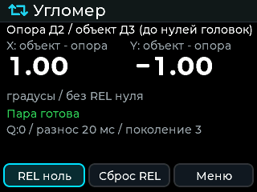
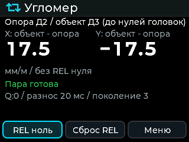
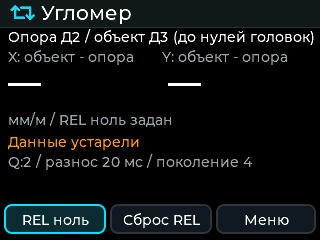
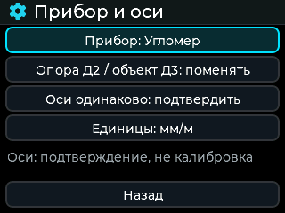

# STM32 1.6.0: Креномер / Угломер

Рабочая ветка `feat/stm32-level-745101`, исходная база `c1eab61`.
Изменения ограничены `BWM427_Inclinometer`. `Core/Src/main.c` совпадает с чистой
базой: чужой тест RS485 из `diplom_project` сюда не переносился.

## Реализовано

- Один runtime, два режима. «Настройки → Прибор → Прибор и оси» в штатном
  плиточном меню (в списочном — «Настройки → Прибор и оси»): Креномер/Угломер,
  перестановка ролей Д2/Д3, явное подтверждение одинаковых осей, градусы/мм/м.
  Старый главный экран креномера сохранён; новый экран вынесен в `ui_level.c`.
- Источник относительного измерения — декодированные ответы головок **до**
  `off_x/off_y`, медианы и EMA. Δ = объект − опора по X/Y. REL zero вычитает
  отдельное смещение пары, не трогает нули головок. Подтверждение осей не
  является калибровкой. Роли ограничены различными адресами 2 и 3.
- Валидация и публикация пары перенесены из `tab5_relative.*`: missing=1,
  stale=2, skew=4, axes=8, warmup=16, range=32, error=64; возраст ≤500000 мкс,
  разнос ≤50000 мкс; головы в диапазоне ±90°. Здоровая новая пара публикуется
  только после новых валидных ответов **обеих** головок. Чтение status и
  перерисовка не создают отсчёты; после ошибки/устаревания восстановление тоже
  требует обеих головок. Настройки и REL zero создают новое поколение и барьер
  fresh-both. REL zero/reset не сохраняются во flash.
- `ref_us/obj_us` — местное время окончания приёма ответа, с разрешением
  HAL tick **1 мс**, расширенное до 64 бит; это не аппаратная синхронизация.
  `hardware_sync` всегда false. мм/м = `1000 * tan(Δ * π / 180)` после REL zero,
  для |Δ| ≥89,9° выводится прочерк и пояснение о диапазоне тангенса; wire/CSV
  сохраняют углы в градусах.

Основные файлы: `Core/Inc/relative.h`, `Core/Src/relative.c` — математика,
публикация и CSV; `Core/Src/instrument.c` — runtime-владелец, роли, настройки,
барьеры и блокировки; `app.c` подаёт реальные результаты транзакций;
`ui_level.c` — отдельный LVGL-экран/настройки; `usb_cli_ext.c` — API;
`sd_logger.c` — выбор отдельного формата записи.

## Wire API

`ver`: `BWM427 fw=1.6.0 board=stm32f411 chip=stm32f411 proto=2`, далее
`default_instrument=heel|level` и маркер образа для прежней проверки F411.
Обычный status сохраняет прежние поля и добавляет `board`, `platform`, `proto`,
`dual_mode_cap:true`, **`instrument_control_cap:true`**, **`relative_data_cap:true`**,
`instrument:"heel"|"level"`. Возможности не выводятся из номера версии.

Поддержаны команды контракта:

```text
instrument heel | instrument level     -> OK instrument
relative roles 2 3 | relative roles 3 2
relative axes confirm | relative axes reset
relative zero | relative reset
relative status                       -> JSON, затем OK relative
```

Остальные успешные относительные команды отвечают `OK relative`. Недопустимые
аргументы, запись, передача files/get, активный samples и сервисная операция
блокируют изменение режима/ролей/осей/REL zero. STM32 обновляется переходом
в ROM DFU с перезапуском: во время DFU application CLI не исполняется.
`relative status` содержит все 29 полей CONTRACT, включая исходные головки,
Δ до/после REL zero, offsets, ages, provenance, quality и generation.
Невалидные измерения — JSON null. Новое форматирование не зависит от поддержки
`%f`/`%llu` в embedded nano printf.

## Запись и settings

Штатный тумблер записи в режиме Угломер открывает **только**
`YYYY-MM-DD_MNNN_REL.CSV`. В этом режиме логгер не создаёт D2/D3 CSV кренования.
Смена режима во время записи отклоняется. При возврате в Креномер прежние
D2/D3, масштабирование, нули и формат остаются прежними. Legacy S/R также
остаются данными отдельных головок; относительные данные выдаёт новый API.
Новые удалённые команды старта SD-записи STM32 в этот контракт не добавлялись.

Заголовок REL **побайтно совпадает** с существующим Tab5, 28 столбцов:

```text
EventMs;EventSensor;Reference;Object;RefUs;ObjUs;RefSeq;ObjSeq;RefAgeUs;ObjAgeUs;SkewUs;Quality;Ready;AxesConfirmed;RefX;RefY;ObjX;ObjY;LiveDX;LiveDY;OffsetValid;OffsetX;OffsetY;RelDX;RelDY;Generation;Event;ObservedUs
```

SAMPLE — только новая принятая пара; GAP/RECOVERY — аудит перехода качества,
не выдуманные ответы головок. EventMs — младшие 32 бита местного времени
приёма ответа, завершившего пару, / события в миллисекундах; ObservedUs — время
наблюдения события. Невалидные углы пустые, дробная точка; CSV не содержит NaN/Inf.
Номера REL участвуют в общем поиске следующего номера, файлы создаются
через FA_CREATE_NEW, синхронизация и обработка ошибок карты общие.

Формат SET1 сохранён: 32 байта, CRC по прежним 28 байтам, прежние offsets полей.
В резервном слове offset 26 хранится `0xA600 | mode | swap<<1 | axes<<2 | units<<3`.
Старая запись с reserved=FFFF и неизвестный формат используют defaults нового
образа; обычные настройки продолжают читаться. REL offset и нули головок
в этот payload не входят; прежние правила head-zero сохранены.

## Сборки и результаты

Оба bin собраны одним кодом с обычным UI=1, без добавления симуляции в firmware:

```sh
export PATH=/c/Users/aaaor/gcc/bin:$PATH
tests/host/run.sh
make -j8 SHELL=/usr/bin/sh BUILD_DIR=build-heel DEFAULT_MODE=0
make -j8 SHELL=/usr/bin/sh BUILD_DIR=build-level DEFAULT_MODE=1
```

`GCC_PATH` по умолчанию — `C:/Tools/arm-gnu-toolchain/bin`.
`DEFAULT_MODE` задаёт APP_DEFAULT_INSTRUMENT и различимое ver/default identity;
оба образа версии 1.6.0 переключаются в оба режима. Если mode уже сохранён,
он имеет приоритет над default образа; предыдущие настройки не стираются.

| Образ | RAM по linker | Flash по linker | Размер bin |
| --- | ---: | ---: | ---: |
| default heel | 97680 / 131072 | 239844 / 393216 | 239844 |
| default level | 97680 / 131072 | 239844 / 393216 | 239844 |

Запас: RAM 33392 байта, Flash 153372 байта. RAM включает резерв heap/stack
линкера около 8 КиБ и статическую кучу LVGL. Сектор settings 7 остаётся вне
области кода. Это статическая оценка/link map, не измерение стека на плате.
Выходы ELF/HEX/map находятся в build-heel и build-level; именованные bin и
машиночитаемый manifest — в `build_release/`.

SHA256:

- `STM32-1.6.0-default-heel.bin`: `7c7318a1333034b06a156901a94a8d98c6eff193a103977c05af78945a2c783f`.
- `STM32-1.6.0-default-level.bin`: `6fb41d83bb41996656919718032ce1fe4cf75ce57e25dcf0e49520360f1df470`.

Проверено без физических COM и прошивки:

- Host: relative core (включая отдельный запуск с default level),
  **589** проверок приложения/логгера и **524** CLI, без ошибок. Пройдены
  миграция настоящего старого SET1 payload, REL/head-zero независимость,
  запись/потеря/возврат головки, REL-only нумерация, возврат к обычным файлам,
  роли/оси/барьеры, блокировки записи/samples/files, JSON29/null/capabilities
  и точное совпадение Tab5 header28. Runner — `tests/host/run.sh`.
- Обычные ARM UI-сборки обоих defaults, векторы F411, размер образов и
  различимость default identity проверены; linker RAM/Flash в таблице выше.
- Офлайн LVGL sim, меню 1 и штатное меню 2: прежние сценарии и новый Угломер
  прошли с exit 0. Реальными encoder-событиями проверены выбор режима, ролей,
  осей и единиц, а также 20 циклов возврата между экранами. Рост занятой кучи
  не обнаружен (список 30464→30440; плитки 22048→21996 байт).
  Сценарий: `tools/ui_sim/build/menuN/ui_sim.exe <output-dir> level`.

Снимки ниже — реальный офлайн-рендер LVGL из этой сборки, не фотография платы:






Ограничения: не проверены физические головки, точность часов/RS485, SD-карта,
энкодер и дисплей платы, работа через реальный USB/DFU, измерительная точность
и динамический максимум стека. Advanced workspace Tab5 не переносился.
Коммиты только локальные; отправку/выпуск координирует родительская задача.
