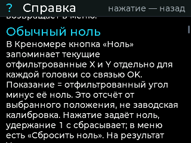
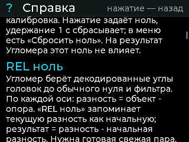
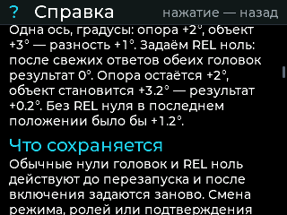
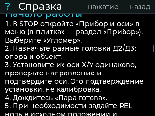
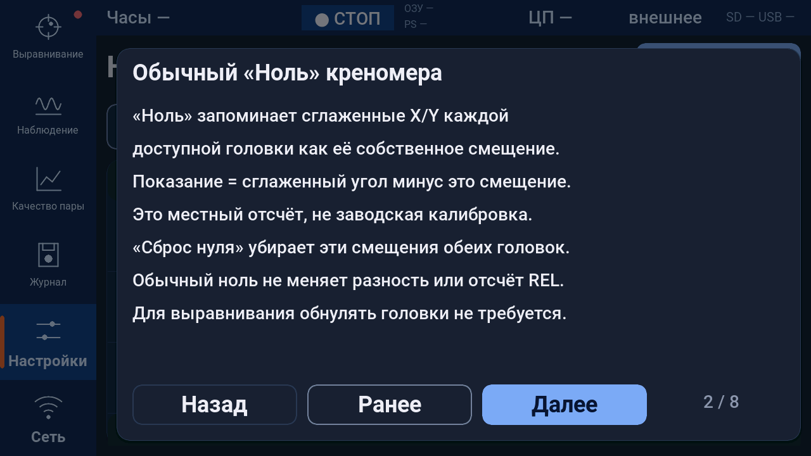
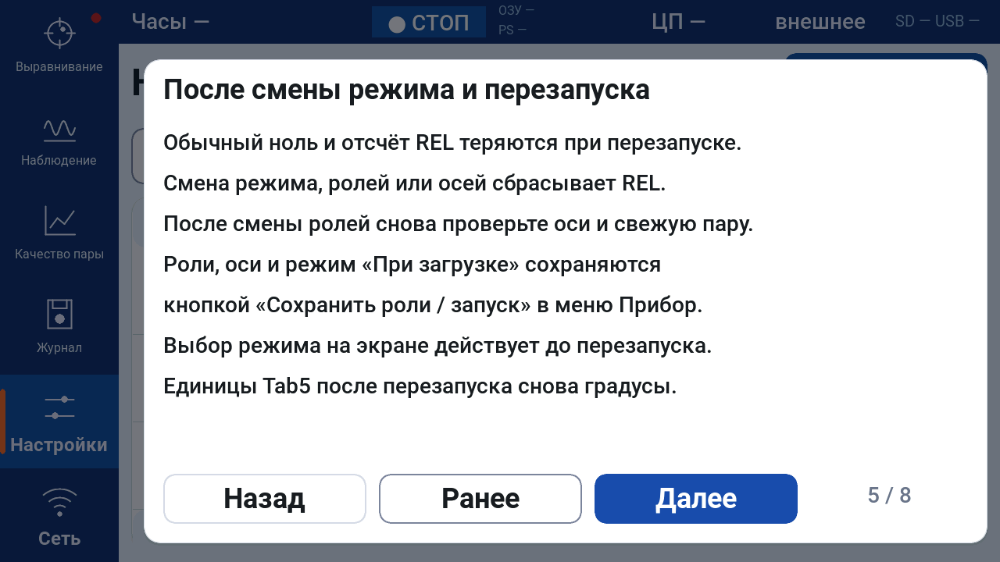

# Справка угломера: обновление 11.11.2026

Запрос: объяснить обычный ноль и REL-ноль, порядок использования и функции
самого прибора. Развёрнутая инструкция: [UGLOMER_HELP.md](UGLOMER_HELP.md).

STM32 1.6.1 содержит 16 разделов в прежней «Справке». Она доступна из обоих
режимов: вращение энкодера прокручивает текст, нажатие возвращает в меню.
Tab5 1.8.6 содержит страничную справку с навигацией касанием и энкодером.
Новые номера отличают бинарники со встроенной справкой от прежних выпусков.
Измерительная математика, протокол, настройки и форматы журналов не менялись.
PC 1.9.0 остаётся совместимым; новый EXE для этого исправления не нужен.

## Программные проверки

- STM32: 589 проверок приложения/логгера и 524 CLI, оба default-образа,
  relative core и шрифты. Шесть офлайн UI-прогонов: обычный режим, угломер
  и новая справка в двух меню. 16 входов в справку, прокрутка до конца и
  обратно, возврат режима и отсутствие роста занятой кучи проверены.
- STM32 по map: RAM 97680/131072, Flash 244916/393216 байт для каждого BIN.
- Tab5: четыре профиля default/controls для P4 rev1/rev3, финальные версии,
  заголовки образов, содержимое справки, SHA/manifest и аппаратные профили.
  Отдельно проверены страницы справки и возврат энкодером на программном UI.
- Перед публикацией BIN прочитаны проверкой образов PC, ZIP проверены по CRC;
  после публикации файлы скачаны обратно и сверены по SHA-256.

Это программные проверки. COM, реальные платы и перепрошивка в этом задании
не использовались; точность измерения и работа физического оборудования
этим обновлением не подтверждаются. Статическая память/стек не равны
измеренному динамическому максимуму на плате.

## Реальные офлайн-кадры STM32

Это рендеры LVGL из той же реализации, не фотографии дисплея платы.
Дата 07.10.2026 на первом экране — фиксированная дата существующего
симулятора. В BIN версия 1.6.1 и дата компиляции Nov 11 2026.

## Реальные офлайн-кадры Tab5

На программном production-рендере проверены восемь страниц, обе темы и оба
режима: 13812 проверок касания, энкодера, возврата, состояния, глифов,
геометрии и выделений памяти. Физический дисплей этим не проверялся.

