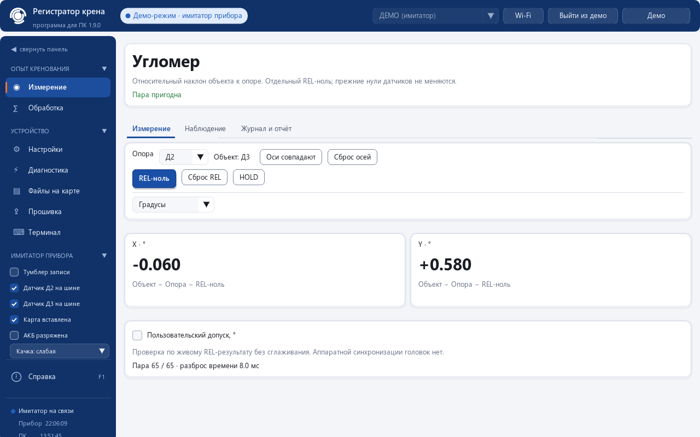
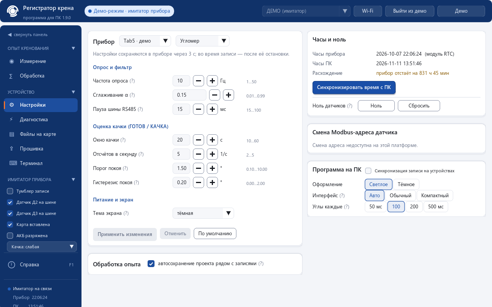

# Креномер / Угломер: проект и платформы

**PC 1.9.0** — одно приложение `krenomer.exe` для STM32F411 и M5Stack Tab5 /
ESP32-P4. В каждой платформе используются две головки BWM427 по RS485/Modbus.
Аппаратная платформа определяется автоматически после подключения. Рабочий
прибор **«Креномер» / «Угломер»** выбирается независимо в «Настройках»;
на подключённом устройстве действует режим, подтверждённый его статусом.

[Скачать и проверить состав комплекта](RELEASES.md#pc-190) ·
[Программа PC и F1](../pc/README.md) · [Главная страница](../README.md).
Комплект: [PC 1.9.0](https://github.com/Sasavn/heel-test-inclinometer/releases/tag/pc-v1.9.0),
[STM32 1.6.0](https://github.com/Sasavn/heel-test-inclinometer/releases/tag/stm32-v1.6.0),
[Tab5 1.8.5](https://github.com/Sasavn/heel-test-inclinometer/releases/tag/tab5-v1.8.5).
[Сводка проверок](../pc/docs/VALIDATION_1.9.0.md).

## STM32F411

**Рабочие приборы: Креномер и Угломер** с новой прошивкой STM32 **1.6.0**.
PC подключается через USB CDC (COM-порт), проверяет identity устройства и его
возможности. Старые прошивки креномера не получают угломер от обновления PC.

Аппаратная база: STM32F411, экран ILI9341 320×240, головки BWM427, энкодер,
тумблер записи, SD-карта, часы DS3231. Распиновка, питание, исторический CSV,
сборка и DFU описаны в [технических разделах STM32](../README.md#техническое-описание-stm32f411).
Исходники: [`BWM427_Inclinometer/`](../BWM427_Inclinometer/).

Обновление — **только STM32-образом через DFU** по инструкции соответствующего
релиза. ESP32/Tab5-образы для этой платы не подходят. Возможности записи и
команды проверяются по фактической прошивке, а не по версии PC.

## ESP32-P4 / M5Stack Tab5

**Рабочие приборы: Креномер и Угломер** с новой прошивкой Tab5 **1.8.5**.
Аппаратная база — M5Stack Tab5 / ESP32-P4 с экраном 1280×720 и двумя головками
BWM427. Подключение к PC — USB или TCP/Wi-Fi. После соединения платформа
распознаётся автоматически; IP-адрес сети автоматически не обнаруживается.

Для TCP нажмите «Wi-Fi»: штатная точка доступа — `192.168.4.1:5000`, ключ —
с экрана прибора. В сети общего роутера укажите фактический STA-IP Tab5.
Для USB выберите COM-порт runtime; ROM recovery — отдельный режим.

Исходники, ревизии платы, сборка и ограничения:
[`tab5/README.md`](../tab5/README.md), [транспорт PC/Tab5](../pc/TAB5.md).
Это технические материалы с историческими версиями; состав скачиваемого
комплекта проверяйте по [каталогу выпусков](RELEASES.md).
Обновление — своим OTA-образом либо комплектом ROM recovery **для нужной
ревизии ESP32-P4**. Образ STM32 и пакет для другой ревизии не подходят.

## Креномер

Показывает углы X/Y головок и качку, записывает данные на PC и работает с
доступными файлами прибора. Обработка опыта кренования включает положения
груза, расчёт метацентрической высоты, графики и отчёты. Порядок подготовки,
плечи, знаки и способы расчёта описаны в [справке PC](../pc/README.md).
Поддержка синхронизации записи и других команд зависит от capabilities
прошивки; исторический номер bundle не является признаком их наличия.

## Угломер: реальная разность наклонов

Назначьте разные адреса головок **«Опора»** и **«Объект»** (обычно 2 и 3).
На обеих головках должны совпадать направления осей и ориентация крепления.
Пользователь подтверждает установку осей; это не калибровка и не
автоматическое исправление взаимного разворота.

Для каждой оси исходная разность **Δ = Объект − Опора**.
**REL-ноль** сохраняет текущую пригодную разность Δ₀ отдельно от нулей
головок. После REL показание равно **Δ − Δ₀**; сброс REL возвращает исходную
разность. Смещение временное: после перезапуска проверьте привязку заново.
Градусы показывают разность наклонов по выбранной оси;
**мм/м = 1000 · tan(отображаемый угол · π / 180)** выражает её как уклон.
Например, 0,1° соответствует примерно 1,745 мм/м. Это не перемещение точки
в миллиметрах и не полный пространственный угол при произвольном развороте.

### Пригодность результата

Новая пара требует нового корректного ответа **от обеих** головок. Повторный
статус или перерисовка не создают измерение. Пара должна иметь `ready`,
`quality = 0`, подтверждённые оси и конечные значения. Порог свежести —
500 мс; максимально допустимый разнос времени приёма — 50 мс.

| Quality, бит | Что не позволяет использовать результат |
|---|---|
| 1 | Нет ответа одной из головок |
| 2 | Устаревшие данные |
| 4 | Слишком большой разнос времени приёма |
| 8 | Не подтверждены оси |
| 16 | Прогрев / накопление данных |
| 32 | Выход за диапазон |
| 64 | Ошибка головки или данных |

Quality — набор флагов, **не оценка погрешности**. Временные метки относятся
к приёму ответов контроллером, аппаратная синхронизация не заявляется.
Смена прибора, ролей, осей или REL-ноля делает старую пару недействительной.
Во время записи, передачи файлов или обновления эти настройки блокируются.
При отсутствии данных нельзя подставлять нулевой наклон.

Две головки измеряют **разность наклонов в двух местах установки**.
Контроль плоскостности поверхности требует схемы точек, базирования и
отдельной методики. Наличие REL, единиц мм/м и отчёта эту задачу не решает.

## Офлайн-демо и проверка оборудования

Офлайн-демо показывает обе платформы и оба прибора на имитированных данных.
Актуальные снимки PC 1.9.0 получены программным стендом реального приложения;
снимки STM32 1.6.0 — офлайн-рендер LVGL. Они не являются фотографиями плат.

Сборка, unit/host-тесты, демо, связь с устройством и аппаратные измерения
фиксируются раздельно в release notes. Текущая документационная работа
не включала подключение или прошивку оборудования. Прошлые аппаратные
receipts относятся только к указанным в них версиям и условиям.
Ни программа, ни quality, ни расчётные проверки не подтверждают поверку,
метрологическую аттестацию или одобрение Российского морского регистра.
