# Регистратор крена — программа для ПК (`krenomer.exe`)

Программа для Windows к [регистратору крена](../README.md) (STM32F411 + два
инклинометра BWM427): показывает углы и качку обоих датчиков с графиками,
диагностику шины RS485, меняет настройки прибора, скачивает файлы замеров с карты
памяти и обновляет прошивку — всё кнопками, без запоминания команд. Работает с
прибором по USB (виртуальный COM-порт), находит его сама и сама переподключается.

Один файл `krenomer.exe`, без установки и без DLL; **Windows 7 SP1 и новее**
(64-битная сборка и 32-битная — для 32-битной Windows 7). Версия **1.8**: в сведениях о файле
(Свойства → Подробно: «Регистратор крена», 1.8.0.0) и в манифесте (без повышения прав, Windows 7–11,
DPI по монитору) — `src/app.rc.in`, `src/app.manifest.in`; номер версии один — `project(VERSION)` в
`CMakeLists.txt`, с `kAppVersion` он сверяется при сборке.

<p align="center">
  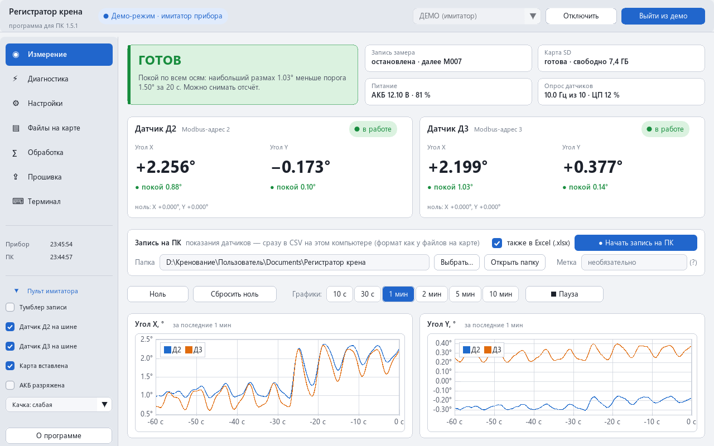
</p>
<p align="center">
  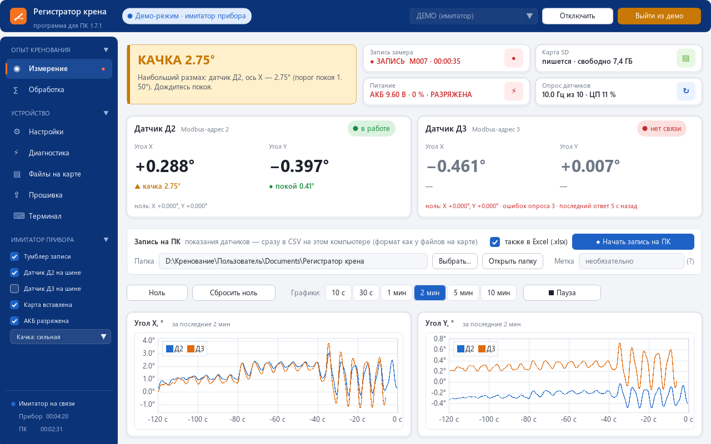
  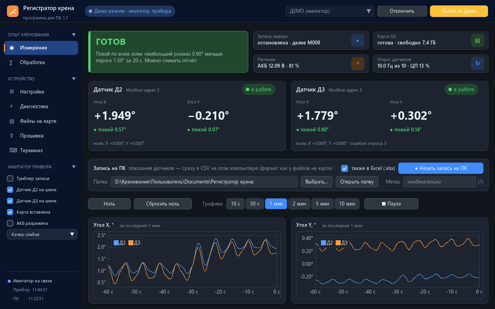
</p>
<p align="center">
  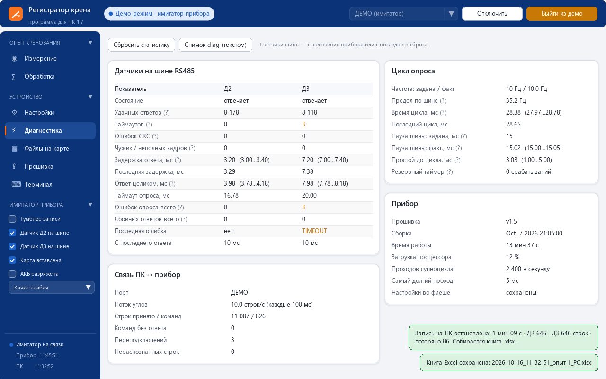
  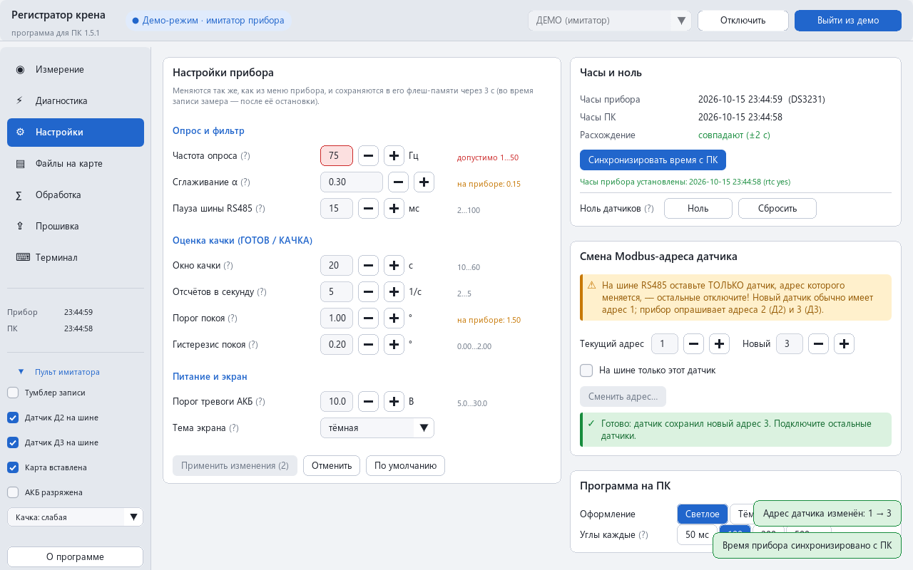
</p>
<p align="center">
  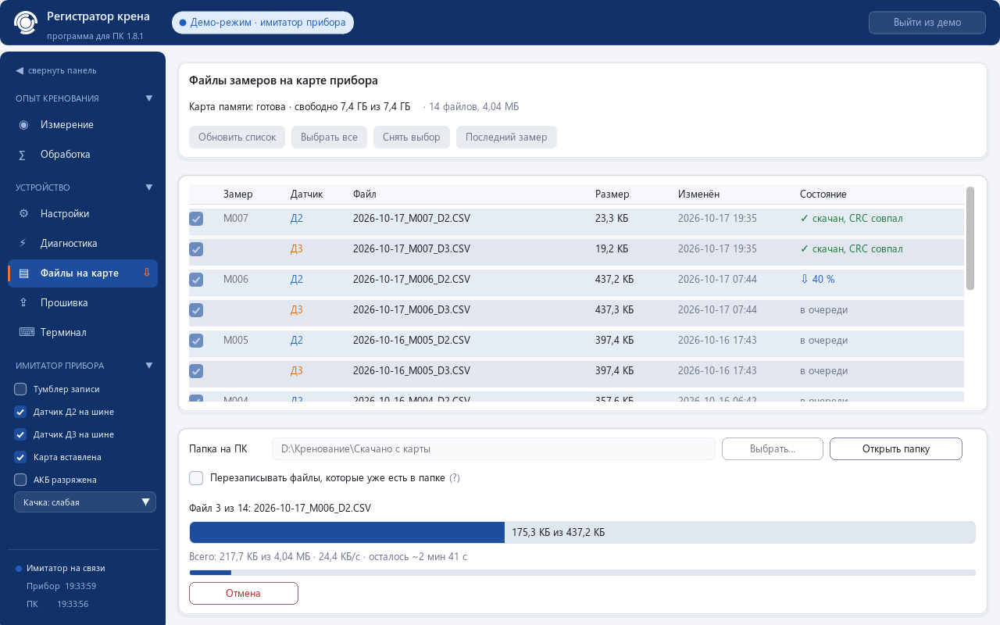
  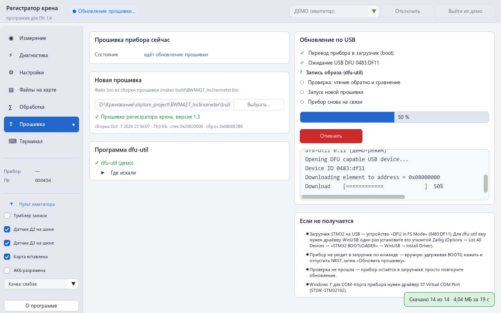
</p>
<p align="center">
  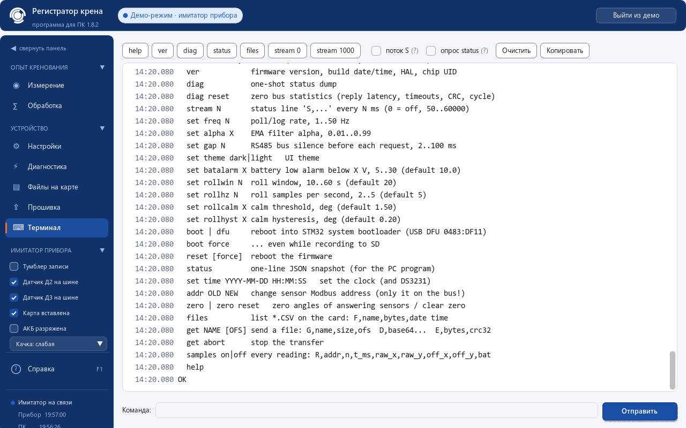
  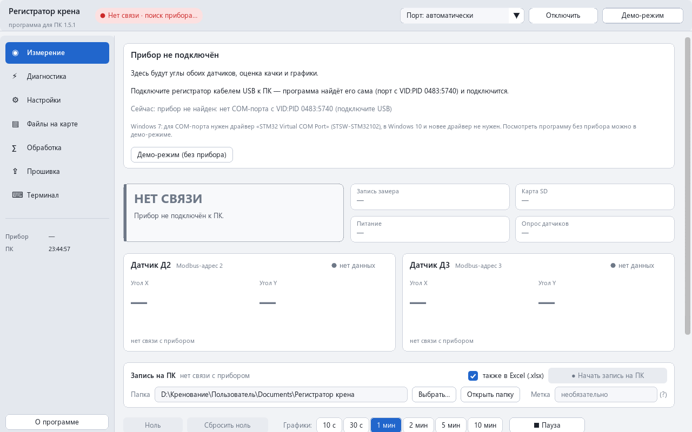
</p>
<p align="center"><sub>Снимки — стенд <code>tests/ui_shots.cpp</code> (демо-режим, имитатор прибора, без окна и видеокарты).</sub></p>

**Вид (с 1.6)** — как у веб-дашборда: тёмно-синие шапка и левая панель, светлая рабочая область, белые карточки
со скруглением и мягкой тенью, вкладки с подчёркиванием, акценты синий / зелёный / оранжевый (тёмная тема — в том
же духе). Левая панель — группами (раскрываются / сворачиваются): **«Опыт кренования»** (Измерение, Обработка) —
первой, **«Устройство»** (Настройки, Диагностика, Файлы на карте, Прошивка, Терминал); в демо-режиме — блок
«Имитатор прибора» (пульт); внизу — связь, часы прибора и ПК, «О программе».

## Содержание

- [Возможности](#возможности)
- [Что нужно на ПК](#что-нужно-на-пк)
- [Как пользоваться](#как-пользоваться)
- [Запись на ПК](#запись-на-пк)
- [Обработка: опыт кренования](#обработка-опыт-кренования)
- [Сборка](#сборка)
- [Устройство программы](#устройство-программы)
- [Протокол с прибором](#протокол-с-прибором)
- [Тесты и снимки экрана](#тесты-и-снимки-экрана)
- [Ограничения и что дальше](#ограничения-и-что-дальше)
- [Лицензии](#лицензии)

## Возможности

| Страница | Что на ней |
|---|---|
| **Измерение** | Сводка крупно: «ГОТОВ» (покой по всем осям), «КАЧКА 2.10°» (худшая ось и её датчик), «СБОР ДАННЫХ 12 из 20 с» (окно качки ещё не заполнено), «НЕТ ДАТЧИКОВ». Плитки: запись (идёт ли, номер замера, время), карта (готова / нет / ошибка, свободное место), питание (напряжение и заряд АКБ, тревога, питание от USB), опрос (фактическая и заданная частота, загрузка процессора). Карточки датчиков Д2 и Д3: углы X и Y крупно, состояние («в работе» / «нет связи» / «не подключён»), качка по каждой оси («покой · размах 0.12°», «качка 1.23°», «сбор 12 из 20 с»), ноль, ошибки опроса. **Запись на ПК** (прошивка 1.5): каждый отсчёт обоих датчиков — сразу в CSV на компьютере (формат файлов карты), по желанию и в книгу Excel; время записи, строк и частота по датчикам, потерянные отсчёты, имена файлов. Кнопки «Ноль» / «Сбросить ноль» (с подтверждением). Графики углов X и Y обоих датчиков за 10 с, 30 с, 1, 2, 5 или 10 мин, пауза |
| **Диагностика** | По каждому датчику: удачные ответы, таймауты, ошибки CRC, чужие и неполные кадры, задержка ответа (средняя, мин.…макс., последняя), время ответа целиком, таймаут опроса, ошибки и сбойные ответы с включения, последняя ошибка, давность ответа. Цикл опроса: заданная и фактическая частота, предел по шине, время цикла, пауза шины (заданная и измеренная), простой перед циклом, резервный таймер. Прибор: прошивка, время работы, загрузка, суперцикл. Связь ПК ↔ прибор. «Сбросить статистику» (`diag reset`) и «Снимок diag» — полный текст `diag` с копированием |
| **Настройки** | Частота опроса, сглаживание α, пауза шины, окно качки, отсчётов в секунду, порог покоя, гистерезис, порог тревоги АКБ, тема экрана прибора — с пределами из прошивки (`app.h`, `bwm427.h`): значение вне пределов подсвечивается, «Применить» отправляет только изменённое и показывает ответ прибора. Часы прибора и ПК, расхождение, «Синхронизировать время с ПК». Ноль. Смена Modbus-адреса датчика: предупреждение «на шине только этот датчик», подтверждение, ход и итог. Оформление программы, интерфейс (авто / обычный / компактный), частота потока углов, автосохранение проекта опыта |
| **Файлы на карте** | Список `*.CSV` на карте (замер, датчик, размер, время), выбор (все / последний замер), папка на ПК, скачивание с прогрессом (файл, всего, скорость, сколько осталось), проверка CRC-32 каждого файла, отмена. Во время записи замера недоступно. Файлы, которые уже есть в папке, не скачиваются заново (если не отмечено «Перезаписывать») |
| **Обработка** | Опыт кренования по файлам замеров (скачанным с карты или записанным на ПК; прибор не нужен), по мотивам программы обработки BWM427_Analyzer: установившийся крен каждого файла (среднее за последние N с), метацентрическая высота h по каждому замеру и посту и итог (среднее), дополнительно — h по МНК; своё плечо переноса у каждого замера; графики крена носового и кормового постов («Правый борт (+)» / «Левый борт (−)», пунктир — среднее); проверка по Правилам РС: h по табл. 6.5 рядом с текущим, оценка качества 6.6, требования ✓/✗/—, график контроля «момент – tg θ»; отчёт `Отчет_Кренование.xlsx` (с листом «Проверки») и графики `График_Нос.png`, `График_Корма.png`, `График_контроля.png` |
| **Прошивка** | Текущая версия прибора; выбор `.bin` и проверка образа (векторы, размер, строка версии в образе); поиск dfu-util; обновление по шагам: `boot` → USB DFU 0483:DF11 → запись → чтение обратно и побайтное сравнение → запуск → прибор снова на связи, версия. Журнал dfu-util. Если идёт запись — «Прервать запись и обновить» (`boot force`) |
| **Терминал** | Любая команда прибора вручную, история (↑/↓), быстрые кнопки (`help`, `ver`, `diag`, `status`, `files`, …), весь обмен с прибором, по флажкам — поток `S,…` и опрос `status` |

Ещё: **демо-режим** — встроенный имитатор прибора с тем же протоколом (поток,
`status`, файлы с содержимым, `get`, смена адреса, перезагрузка, «перепрошивка»
без dfu-util), с пультом слева: тумблер записи, датчики на шине, карта, АКБ, сила
качки. Светлая и тёмная темы. Окно — от 1000×620; на экранах до 1366×800
открывается развёрнутым. Масштаб под DPI монитора.

## Что нужно на ПК

- **Windows 7 SP1** и новее. `krenomer.exe` — 64-битный; для 32-битной Windows 7 —
  сборка `build-win7-x86.cmd`. Ничего не устанавливается (статическая сборка, без
  Visual C++ Redistributable). Видеокарта — OpenGL 3.0, на старых встроенных и в
  удалённом рабочем столе — OpenGL 2.1/1.1 (переключается сама).
- **Драйвер COM-порта прибора.** Windows 10/11 подключает стандартный `usbser.sys`
  сама. **Windows 7** — нужен драйвер ST «STM32 Virtual COM Port» (STSW-STM32102,
  с сайта st.com), один раз; после него прибор виден как «STMicroelectronics Virtual
  COM Port (COMx)».
- **Для обновления прошивки:** `dfu-util.exe` (0.9 или новее, сборка для Windows) —
  рядом с `krenomer.exe` или в папке `dfu-util` рядом с ним; программа найдёт и
  копию из Arduino IDE (`%LOCALAPPDATA%\Arduino15\…\dfu-util`), `PATH` и переменную
  `DFU_UTIL`. Загрузчику STM32 (USB DFU 0483:DF11, «STM32 BOOTLOADER») нужен
  драйвер **WinUSB** — один раз утилитой [Zadig](https://zadig.akeo.ie/) (работает
  и в Windows 7): Options → List All Devices → STM32 BOOTLOADER → WinUSB → Install.
- **Для записи на ПК** — прошивка прибора **1.5** или новее (команда `samples`); со
  старой прошивкой всё остальное работает, а кнопка записи недоступна с подсказкой
  «нужна прошивка 1.5».
- Настройки программы (папка для файлов, окно графиков, тема, …) —
  `%APPDATA%\Krenomer\krenomer.ini`. Запускается одна копия программы (COM-порт
  может открыть только одна).

## Как пользоваться

1. Подключите прибор кабелем USB и запустите `krenomer.exe` — в шапке появится
   «На связи · COMx · прошивка v1.4». Если не появилось — подсказка на странице и
   во всплывающей подсказке над плашкой связи (нет порта, порт занят, драйвер).
2. **Измерение** — для опыта кренования: после переноса груза дождитесь «ГОТОВ»
   (качка по всем осям меньше порога за окно), затем снимайте отсчёт. Запись
   замера на карту включается тумблером на приборе; сразу на компьютер —
   кнопкой «Начать запись на ПК» (см. [Запись на ПК](#запись-на-пк)).
3. **Файлы на карте** — после замера (тумблер в STOP): «Последний замер» →
   «Скачать выбранные»; файлы ложатся в «Документы\Регистратор крена» (или
   выбранную папку), каждый проверен CRC.
4. **Обработка** — D, P, L и плечо каждого замера → h и отчёт Excel (см.
   [Обработка](#обработка-опыт-кренования)); по умолчанию — та же папка.
5. **Настройки** — поменять значения и «Применить»; прибор сохранит их во флеш
   через 3 с (во время записи — после её остановки).
6. **Прошивка** — выбрать `BWM427_Inclinometer.bin` (из `make`), «Обновить
   прошивку…».

Без прибора: кнопка «Демо-режим» (или `krenomer.exe --demo`) — все страницы
работают с имитатором.

## Запись на ПК

Карточка «Запись на ПК» на странице «Измерение»: каждый свежий отсчёт обоих
датчиков приходит с прибора по USB (команда `samples`, **прошивка 1.5**) и сразу
пишется в CSV на этом компьютере — тем же форматом, что файлы на карте, поэтому
они открываются в Excel двойным щелчком и обрабатываются так же. Карта для этого
не нужна; тумблер записи на приборе независим (можно писать и на карту, и на ПК).

<p align="center">
  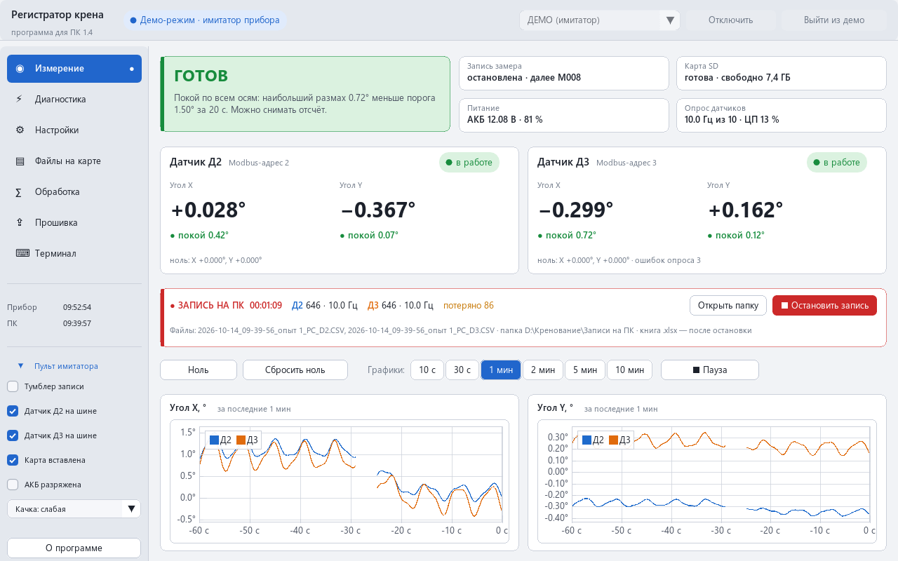
  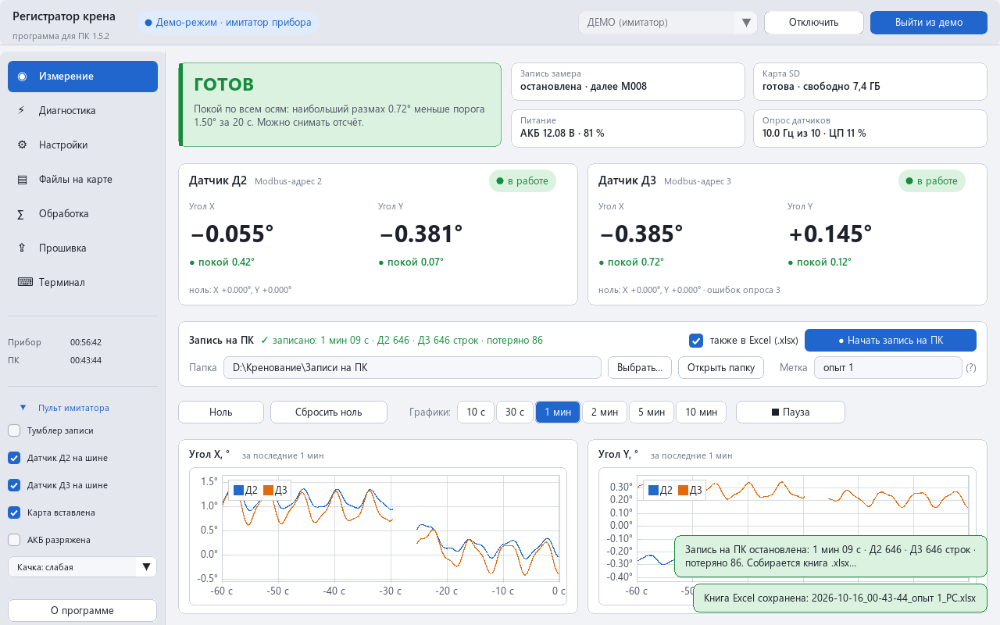
</p>

- **Управление:** папка (по умолчанию — та же, что для файлов с карты,
  «Документы\Регистратор крена»; запоминается), метка замера (необязательно — в
  имя файлов), «также в Excel (.xlsx)», «Начать запись на ПК» / «Остановить
  запись», «Открыть папку». Во время записи — её время, строк и частота по каждому
  датчику, потерянные отсчёты, имена файлов; у пункта «Измерение» в меню —
  красная точка. На невысоком окне (1024×700) карточка — в одну строку.
- **Файлы** — по файлу на датчик: `ГГГГ-ММ-ДД_ЧЧ-ММ-СС[_метка]_PC_Dk.CSV` (дата и
  время начала по часам ПК, `k` — Modbus-адрес), например
  `2026-10-08_17-19-28_PC_D2.CSV`, `2026-10-08_17-19-28_опыт 3_PC_D3.CSV`. Файл
  датчика заводится с его первым отсчётом (датчик, подключённый посреди записи,
  получает свой файл). Существующие файлы не перезаписываются: при совпадении
  имени — « (2)», « (3)», …
- **Формат** — как у карты (прошивка 1.4+, README прошивки, «Формат файлов на
  SD-карте»): шапка, «;», десятичная запятая, LF.

  ```
  Date;Time;RawX;RawY;OffsetX;OffsetY;CalcX;CalcY;BatV;Ms
  08.10.2026;17:19:28;-0,46;-0,17;-0,458;-0,171;-0,002;0,001;11,8;0
  08.10.2026;17:19:28;-0,45;-0,17;-0,458;-0,171;0,008;0,001;11,8;62
  ```

  Числа прибор присылает уже целыми (сотые, тысячные, десятые — округление то же,
  что для карты, `sd_to_scaled`), `CalcX = RawX·10 − OffsetX` считается в целых,
  как в прошивке: значения совпадают с файлом карты, «-0,000» не бывает. Отличие —
  источник времени: `Date`/`Time` — часы ПК в момент приёма строки, `Ms` —
  миллисекунды от первого отсчёта записи по часам прибора (`t_ms` строки R —
  точное время отсчёта; переполнение счётчика не мешает).
- **Надёжность:** строки копятся в памяти и раз в секунду дописываются в файл —
  при сбое программы теряется не больше ~1 с, файл остаётся правильным CSV.
  Закрытие программы посреди записи — штатная остановка (файлы дописываются,
  книга собирается).
- **Excel:** по остановке (если отмечено «также в Excel») — книга `…_PC.xlsx`:
  листы «Д2», «Д3» (те же столбцы; числа — числами с 2 / 3 / 1 знаками, `Date` и
  `Time` — текстом, шапка жирная и закреплена) и «Сводка» (начало, конец,
  длительность, прибор, метка; по датчикам — файл, строк, пропущено отсчётов;
  перерывы связи со временем, перезагрузки прибора). Собирается из записанных CSV
  в фоне; больше 300 000 строк (≈ 2,5 ч при 2 × 16 Гц) — не собирается (память),
  данные остаются в CSV.
- **Потерянные отсчёты.** В каждой строке R — номер ответа датчика `n` (+1 на
  отсчёт); скачок больше 1 — отсчёты не дошли до ПК (прибор не успел отправить
  строку или пропала связь): «потеряно N» в карточке и в «Сводке».
- **Связь пропала** (выдернули кабель, прибор перезагрузился): запись не
  останавливается — файлы открыты, в карточке «нет связи — ждём прибор»; прибор
  вернулся — программа снова шлёт `samples on` (прибор выключает их при открытии и
  закрытии порта), строки идут в те же файлы. Перерыв виден по столбцам `Time` и
  `Ms` и записан в «Сводку»; отсчёты, снятые без связи, на ПК не попадают (есть на
  карте, если шла запись на неё) и считаются потерянными. Прибор перезагрузился
  (`n` и `t_ms` с нуля) — `Ms` продолжается по часам ПК, назад не идёт. Подключили
  прибор со старой прошивкой — запись останавливается с сообщением.
- **Одновременно нельзя:** скачивание файлов с карты, перепрошивка, «Отключить» и
  демо-режим на время записи недоступны (а запись — во время скачивания): передача
  файла заняла бы канал USB, и прибор выбрасывал бы строки R. Ноль, настройки,
  другие страницы — можно; новый ноль меняет столбцы `OffsetX/Y` и `CalcX/Y`, как
  на карте.
- **Частота** — строка на каждый цикл опроса: до ~16 отсчётов в секунду на датчик
  при двух датчиках, ~30 при одном (частота опроса из «Настроек», предел — шина).

## Обработка: опыт кренования

Страница «Обработка» — расчёт по файлам замеров, **по мотивам программы обработки
исходного проекта BWM427_Analyzer (Romero2207,
[github.com/Romero2207/BWM427_Analyzer](https://github.com/Romero2207/BWM427_Analyzer))**:
то же самое — средний крен, h по замерам, итог, графики и отчёт Excel — внутри
`krenomer.exe`, без Python. Прибор не нужен.

<p align="center">
  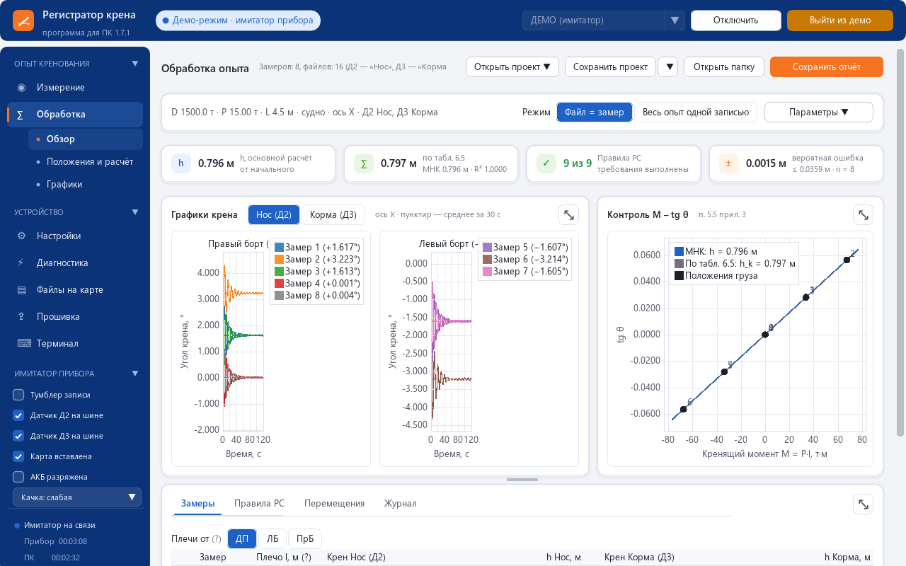
  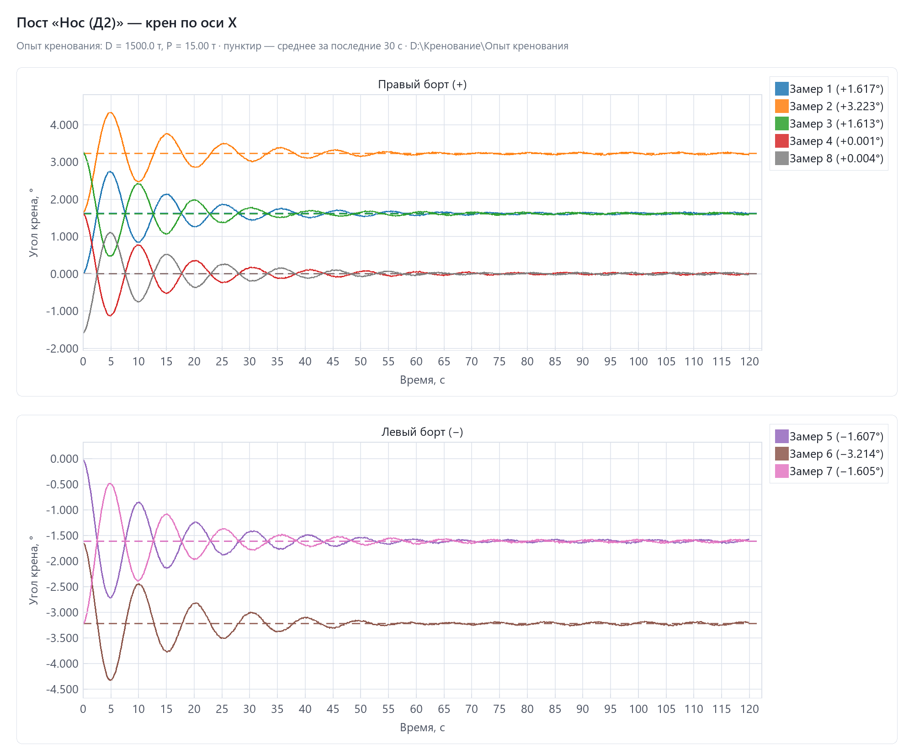
</p>
<p align="center">
  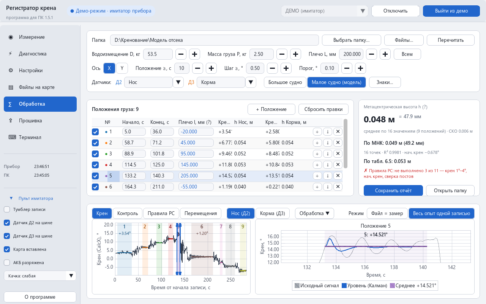
  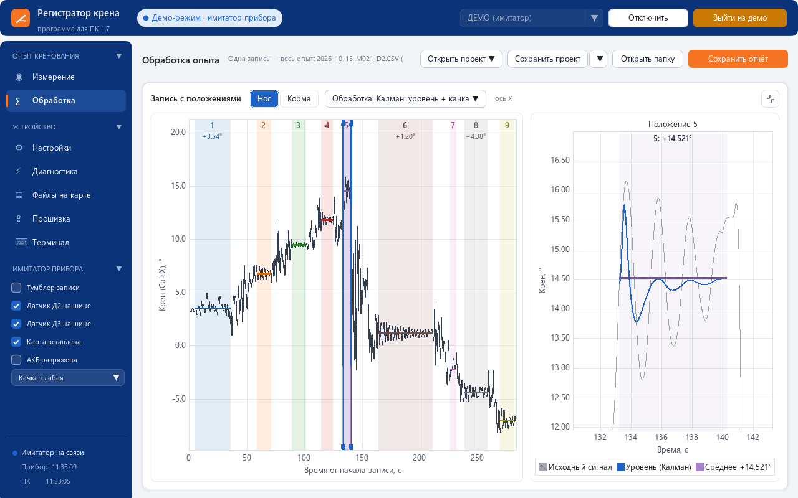
</p>

- **Подпункты** (с 1.7.1) — в левой панели под «Обработкой»: **«Обзор»** (на окне от 1280 × 800 — всё на одной
  странице, как ниже), **«Положения и расчёт»** (параметры, показатели и вкладки — таблица положений, Правила РС,
  перемещения, журнал — во всю ширину) и **«Графики»** (запись с положениями, положение крупно и контроль M – tg θ —
  крупно, друг под другом). На окне уже 1280 или ниже 800 точек (1152 × 864, 1024 × 768) по умолчанию —
  «Положения и расчёт»; показатели там — 2 × 2, чтобы подписи не обрезались. **Страница прокручивается целиком**:
  таблицы и вкладки — во всю высоту, без своей прокрутки; графики в «Обзоре» — своей высоты (делитель под ними).
- **Экран** (дашборд): сверху — «Открыть проект ▼», «Сохранить проект ▼», «Открыть папку» и «Сохранить отчёт»; параметры опыта — строкой (D, P, L, судно,
  датчики, папка, режим; «Параметры ▼» раскрывает полную карточку); ряд компактных карточек-показателей (h основным
  расчётом с пометкой метода и «испр.», второй расчёт и МНК, «Правила РС: n из m», вероятная ошибка или число
  положений); ниже — карточки **«Запись с положениями»** (у «файл = замер» — «Графики крена») и **«Контроль M –
  tg θ»**, под ними — карточка с вкладками **«Положения груза / Замеры», «Правила РС», «Перемещения», «Журнал»**.
  Делитель под графиками задаёт их высоту (доля видимой высоты страницы, запоминается); у каждой карточки — кнопка
  «развернуть на всю область» (и назад).
- **Плечи «от борта»** (с 1.7.1): над таблицей положений / замеров — «Плечи от: ДП / ЛБ / ПрБ» и ширина судна
  (модели) **B** (она же — в параметрах опыта, в единицах судна; хранится в настройках и проекте). «От ЛБ / ПрБ» —
  в столбец вводится расстояние x от борта до центра груза (как мерят: 29,5; 23; … см от ПрБ), рядом серым —
  плечо от ДП: от ПрБ l = B/2 − x, от ЛБ l = x − B/2 («+» — к ПрБ). Переключение меняет только вид ввода — плечи
  не теряются. В отчёте (лист «Протокол») — оба столбца и способ. В режиме «Группы» плечи перемещений — разности,
  способ на них не влияет.
- **Старые экраны (HD ready, 1280×720 / 1366×768)** — компактный интерфейс: «Настройки → Программа на ПК →
  Интерфейс»: «Авто» (по умолчанию — компактный, если окно ниже 800 точек), «Обычный», «Компактный». В компактном
  меньше отступы, шапка в одну строку, левая панель — столбец значков с подсказками (☰ раскрывает её полностью и
  закрепляет, «◀ свернуть панель» — обратно), а на «Обработке» «Запись с положениями» и «Контроль M – tg θ» —
  вкладками в одной карточке на всю ширину, чтобы графику доставалась высота.
- **Файлы** — папка (по умолчанию — папка «Файлов на карте»; запоминается) или
  выбранные файлы. Читаются **все** `*.CSV`, `*.TXT` и **книги Excel `*.xlsx`** (если в
  самой папке их нет — из подпапок), **формат узнаётся по содержимому, а не по имени**
  (`src/core/CsvLog.hpp`). Книга (файл прибора, пересохранённый из Excel) читается без
  библиотек (`src/core/XlsxRead.hpp`: ZIP, распаковка deflate — `Deflate.hpp`, общие строки,
  inlineStr; первый лист со столбцами углов; Date и Time, которые Excel превратил в
  числа-даты, — обратно в дату и время) и дальше разбирается как CSV. Свой отчёт
  `Отчет_Кренование.xlsx`, книга записи на ПК рядом с её CSV и книга-копия CSV с тем же
  именем не читаются. Форматы:
  - прошивка 1.4+: `Date;Time;RawX;RawY;OffsetX;OffsetY;CalcX;CalcY;BatV;Ms`, «;»,
    десятичная запятая;
  - наша прошивка 1.0–1.3: `Time,RawX,RawY,OffsetX,OffsetY,CalcX,CalcY,BatV,Ms`, «,»,
    точка, `Time` — «ДД.ММ.ГГ ЧЧ:ММ:СС»;
  - исходная прошивка Romero2207 (май–июнь 2026, `M_NNN.CSV` и `M_NNN_k.CSV`) — то же
    без `Ms` (по исходникам в истории git: `sprintf("%02d.%02d.%02d %02d:%02d:%02d,%.3f…,%.1f")`);
  - тестовые файлы старого анализатора: `Time,CalcX,CalcY,BatV`, `Time` — «ЧЧ:ММ:СС»;
  - и то, что бывает с файлами после карты и Excel: BOM, UTF-16 («Текст Юникод»),
    CRLF / LF, пустые строки, нули в хвосте (карту выдернули), `sep=;`, разделитель
    «;», «,» или табуляция, запятая или точка, поля в кавычках, единицы в шапке,
    `Time` без секунд, **файл без шапки** (столбцы угадываются по числу полей и виду
    даты/времени).

  Непонятный файл — строка в журнале «не понял формат: <имя>, первая строка: «…»».
  Имя только группирует: `ГГГГ-ММ-ДД_MNNN_Dk.CSV`, `M_NNN_k.CSV`, `M_NNN.CSV` (датчик 1)
  — по номеру замера; записи на ПК `…_PC_Dk.CSV` — одна запись — один замер (в таблице
  — время начала и метка); **файл с любым другим именем, но понятным содержимым —
  отдельная запись** (в таблице — имя файла, пост — нос). Файлы замера — по постам:
  **Д2 — нос, Д3 — корма** (у старых имён 1 — нос, 2 — корма), меняется списком
  «Посты». Время отсчёта — по `Ms` (точное), без него — по `Time` (строки одной
  секунды — равномерно внутри неё; `Time` без секунд — по числу строк в минуте).
  Читаются в фоне. Примеры всех форматов — `tests/data/old` (`tests/make_test_data.py`).
- **Режим** (справа в шапке карточки графиков): **«Файл = замер»** — каждый файл
  (пара файлов постов) — одно положение груза, крен — среднее за последние N с файла;
  **«Весь опыт одной записью»** — груз переносили во время одной длинной записи (см.
  ниже). Выбирается сам при чтении: если в какой-то записи найдено **три положения
  груза и больше** — второй режим; переключается вручную.
- **Исходные данные:** водоизмещение D (т, по умолчанию 1500), масса груза P (т, 15),
  плечо переноса L (м, 4,5 — по умолчанию для всех замеров), ось угла — **X**
  (датчики стоят поперёк судна; Y — как в старой программе), окно — последние
  30 с файла (в режиме записи вместо него — «Положение ≥, с» и «Шаг ≥, °»), порог
  0,1°. Сохраняются в `krenomer.ini` **сразу при изменении** (через ~1 с), а не только
  при закрытии программы. Ось из файла программы 1.2 (без отметки `heel_axis_v=2`) не
  берётся — по умолчанию X.
- **Таблица замеров:** флажок «в расчёте», номер (цвет — как линия на графиках),
  плечо l замера (своё у каждого переноса; со знаком: «+» к правому борту, все положительные — борт по знаку крена, см. [Правила РС](#проверка-по-правилам-рс);
  «Всем» — снова L), по посту — средний крен ± СКО за окно (подсказка: файл, окно,
  точек, АКБ) и h.
- **Расчёт** (`src/core/Heel.hpp` — отдельный модуль: на входе крен и плечо по
  замерам и постам, D, P, на выходе таблица h, итог и МНК):
  - крен поста θ — среднее `CalcX` (или `CalcY`) за последние N с файла;
  - h = P·l / (D·tg|θ|) по каждому замеру и посту; |θ| ≤ порога — не учитывается;
  - **итог — среднее h по всем учтённым значениям** (оба поста), как в старой
    программе, и СКО;
  - отдельной строкой — **по МНК**: прямая tg θ = k·(P·l/D) + b по тем же точкам
    (x со знаком крена), h = 1/k; b — начальный крен (неточный ноль датчика), он
    сдвигает поточечные h, а наклон — нет. Все точки с одним плечом и одного борта —
    прямая через ноль.

  **Формулы перенесены из исходной программы как есть и будут уточняться**
  (руководитель); исправлено только то, что было явной ошибкой: одно плечо L на все
  замеры (теперь у каждого своё), опечатка в имени столбца кормы, время по
  `Time` с шагом 1 с вместо точного `Ms`.
- **Графики** — как у старой программы: для носового и кормового поста по две
  панели «Правый борт (+)» и «Левый борт (−)» (борт — по знаку среднего крена),
  замер — линия крена от времени, пунктир того же цвета — его среднее, в легенде
  «Замер 19 (+2.451°)».
- **«Сохранить отчёт»** — в папку файлов, в фоне. **Отчёт открыт в Excel** (или картинка — в просмотрщике):
  с 1.7.1 весь комплект сохраняется под следующим свободным номером — `Отчет_Кренование (2).xlsx`,
  `График_Нос (2).png`, … — с записью в журнале и сообщением «Отчёт открыт в другой программе — сохранено как …» с
  кнопкой «Открыть папку» (до 1.7.1 книга не сохранялась, а об этом говорили только журнал на вкладке и сообщение
  на 6 с — выглядело как «ничего не делает»). Так же — файл проекта (`Опыт (2).krenomer`). В комплекте:
  - `Отчет_Кренование.xlsx`: лист «Результаты» — строка на замер и пост (файл,
    пост, замер, плечо l, средний крен, СКО, точек, h, АКБ — последнее `BatV`,
    примечание — почему не учтён), «ИТОГОВОЕ СРЕДНЕЕ ЗНАЧЕНИЕ», «По МНК» (k, b,
    R²), исходные данные (D, P, L, окно, ось, порог, формула); лист «Сырые_данные» —
    все строки файлов в расчёте + замер, пост, датчик (числа — числами; до 300 000
    строк). Книга сжата deflate. Файл открыт в Excel — сообщение «файл занят».
  - `График_Нос.png`, `График_Корма.png` — 2000 × 1640, панели друг под другом;
    рисуются тем же кодом, что на экране, своим контекстом ImGui без окна и
    видеокарты (`src/ui/Offscreen.hpp`: программная растеризация, как у стенда
    снимков).
- **Журнал** под итогом: что прочитано (замеров, файлов, посты, формат; у необычных
  файлов — как поняты: «исходная прошивка («,», без шапки — столбцы угаданы)»), что
  пропущено и почему («не понял формат: …, первая строка: …», оборванные строки, два
  датчика на одном посту), сколько положений найдено в записи, куда сохранён отчёт.

### Проект опыта (`*.krenomer`, с 1.7)

<p align="center">
  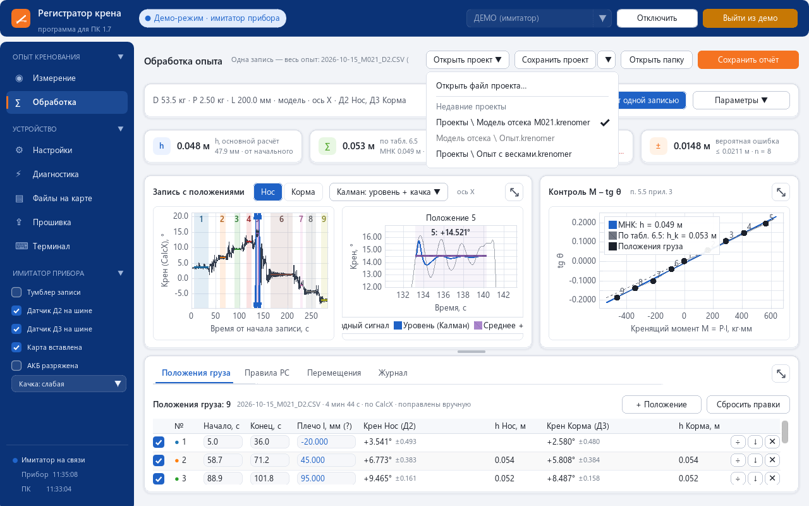
  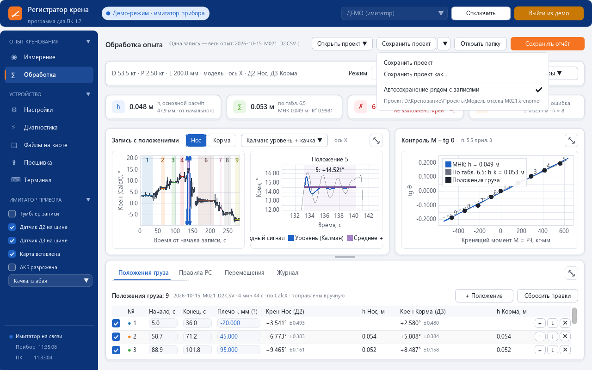
</p>

Опыт сохраняется **файлом проекта** и открывается позже с тем же расчётом — без повторного ввода плеч и правок.
Проект — текстовый JSON в UTF-8 (`src/core/Project.hpp`), в нём:

- **записи** — папка или выбранные файлы: путь относительно файла проекта, если записи рядом (в той же папке, в
  подпапке или в соседней папке), и ещё полный путь. Папку опыта можно переложить или скопировать на другой ПК вместе
  с проектом — записи найдутся;
- **исходные данные** — судно (большое / модель), D, P, L, ось, окно, порог, поиск положений; **датчики** — названия
  постов, обратный знак, участие в расчёте; **метод обработки** и его параметры (свой метод — вместе с текстом
  формул: проект откроется и там, где этого метода нет);
- **Правила РС** — h и l_max по Информации об остойчивости, Δ0, порог сверки, основной расчёт, прибор табл. 6.5, Δh,
  Δ наихудшего варианта, группы крен-балласта и перемещения;
- **опыт** — режим, запись, положения груза с границами, плечами и галочками (ручные правки), плечи и снятые замеры
  «файл = замер», ручное «исключить / учитывать» табл. 6.5; для сведения — h при сохранении (если при открытии h
  другой, журнал скажет: изменились файлы записей или метод).

Кнопки на «Обработке»: **«Открыть проект ▼»** — «Открыть файл проекта…» и список недавних (до 8; переложенный файл —
серым, путь — в подсказке); **«Сохранить проект»** — в открытый проект или `<папка записей>\Опыт.krenomer`, «▼»
рядом — «Сохранить проект как…» и автосохранение. В узком окне — одна кнопка «Проект ▼».

**Автосохранение** (по умолчанию включено; «Настройки → Обработка опыта» или меню «▼»): через 3 с после правки
(плечо, граница, параметр, группа) проект пишется в `Опыт.krenomer` рядом с записями — само открытие папки ничего не
пишет. Папка с `Опыт.krenomer` открывается **вместе с проектом**: плечи, положения и правки — как были.

**Другой опыт начинается с чистого листа**: открыли папку другого опыта без проекта — плечи, перемещения групп,
снятые замеры и правки табл. 6.5 прошлого опыта не переносятся.

Формат версионирован (`"krenomer_project": 1`); ошибки чтения — понятным текстом в журнале и сообщении: «файл пуст»,
«файл повреждён или это не JSON (позиция …)», «это не файл проекта», «поле «ship.D»: ожидается число», «папка записей
не найдена: … рядом с проектом (или полный путь)», «проект сохранён более новой программой … — обновите программу».
Испорченный проект опыт на экране не трогает.

**Записи под похожим именем** (с 1.7.1): файлы, присланные через Telegram или скопированные Проводником, получают
приписки — «2026-10-16_M024_D2 (1).CSV», «… - копия.CSV», другой регистр. Если запись не нашлась ни рядом с
проектом, ни по полному пути, программа ищет в папке проекта и в папке записей файл с тем же именем без приписки
копии и регистра; один такой — берёт его и пишет в журнал, что взято (приписка не мешает и номеру замера и
датчику). Нет ни одного или похожих несколько — карточка «Проект …: не найдены записи — …» с кнопками **«Указать
файлы…»** (записи сопоставляются по имени, иначе по порядку; плечи, положения и правки проекта применяются к ним) и
«Закрыть».

Тесты: `process_test` (все поля туда и обратно, пути, ошибки, версия),
`ui_shots` (опыт с весками и модель M021: сохранить → открыть другой опыт → открыть проект — тот же h и h_k;
автосохранение через 3 с; папка с проектом; новый опыт без проекта — плечи не перенеслись).

### Весь опыт одной записью

Прошивка 1.5 и запись на ПК позволяют писать весь опыт одним файлом: груз переносят
9–10 раз, крен идёт «ступеньками» (на каждой — качка с периодом 5–15 с, при переносе —
всплеск и затухающие колебания). В этом режиме:

<p align="center">
  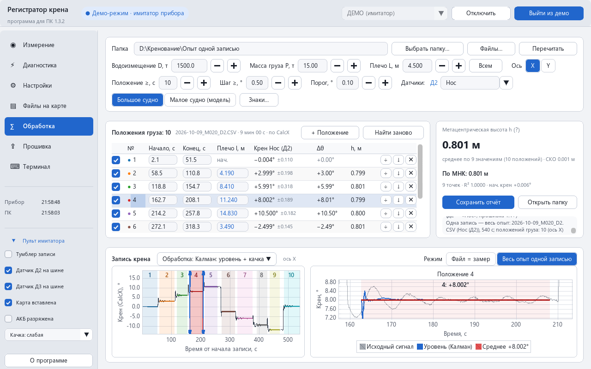
  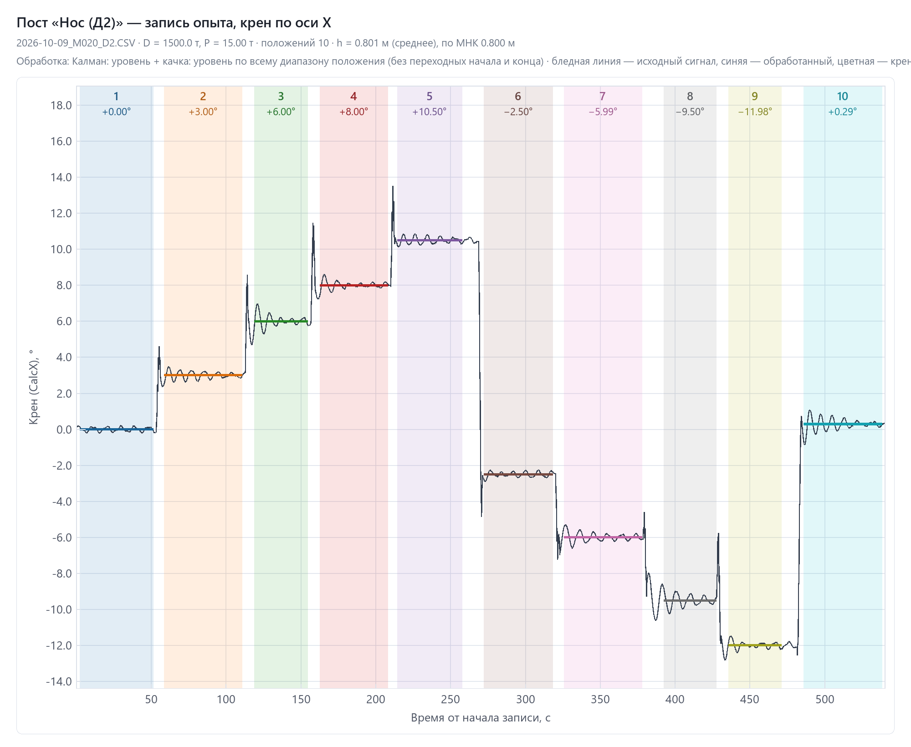
</p>

- **Положения груза** ищет `src/core/Plateaus.hpp` (отдельный модуль без интерфейса,
  параметры — `plateau::Params`): скользящая медиана за 12 с (убирает всплески и
  большую часть качки, ступеньки не размывает) → бинарная сегментация (разрез — где
  сумма квадратов отклонений от средних частей падает сильнее всего; части не короче
  «Положение ≥» = 10 с и отличаются не меньше чем на «Шаг ≥» = 0,5°) → в каждом куске
  — только устоявшаяся часть (сглаженный крен ближе 0,25° — или 15 % перепада к соседям
  — к уровню куска), ещё 2 с запаса с краёв (хвост всплеска) → **выбросы** (отсчёт
  дальше от медианы участка, чем 5 «сигм» по MAD и не меньше 1°: кто-то прошёл, стукнули
  по датчику) не входят в среднее, а выброс в первых / последних 8 с участка — начало
  перехода: край переносится за него → короче 10 с — отбрасываются, соседние с почти
  равным уровнем — сливаются. Крен положения — среднее ± СКО **исходных** отсчётов
  участка без выбросов (качка — в СКО; число выбросов — в подсказке). Ищется по основному
  посту записи (нос, без него — корма), крен второго поста — на тех же участках.
- **График** — вся запись поста: положения — заливка с номером и средним креном
  сверху, линия — средний крен положения. Щелчок по положению — выбрать; **границы
  выбранного перетаскиваются мышью**; колесо — масштаб, двойной щелчок — вся запись.
- **Таблица положений:** в расчёте ли, номер (цвет — как заливка), начало и конец
  (с от начала записи — правятся вручную), плечо l (переноса от начального положения;
  своё у каждого), крен ± СКО, Δθ от начального, h; кнопки «÷» — разделить пополам,
  «↓» — слить со следующим, «✕» — удалить; над таблицей — «+ Положение» (на самом
  длинном свободном участке) и «Найти заново» (сбросить ручные правки). Пересчёт —
  сразу.
- **Расчёт** (`Heel.hpp`, `heel::SolvePositions`): положение 1 (первое учтённое) —
  начальное, его крен — ноль; для остальных Δθ = крен − крен начального,
  h = P·l / (D·tg|Δθ|) (|Δθ| ≤ порога — не учитывается), итог — среднее, и МНК по
  всем положениям: tg Δθ = k·(P·l/D) + b, h = 1/k. Формулы будут уточняться — они в
  отдельном модуле.
- **Отчёт:** лист «Положения» (положение, в расчёте, начало, конец, длительность,
  пост, крен, СКО, точек, Δθ, l, h, примечание; итог, МНК; исходные данные и
  параметры поиска) и «Сырые_данные» (все строки записи + номер положения, в которое
  попала строка); `График_Нос.png` / `График_Корма.png` — вся запись с положениями.

**Настоящая запись руководителя** (09.10.2026, прошивка 1.5, книга Excel
`2026-10-09_M020_D2.xlsx`, 5399 строк, 10 Гц; для тестов — только `Ms`, `CalcX`, `CalcY` в
`tests/data/real`): на графике CalcX, кроме ступенек 0 → 3 → 6 → 8 → 10,5 → −2,5 → −6 → −9 → −12,
есть всплески (67, 181, 380, 436 с) и промежуточные состояния между 8° и 10,5° (провал до ~2° и
~5° — груз переставляли). Первая версия детектора находила 10 положений, но всплески внутри
участков сдвигали уровень (0,25° вместо 0,14° у первого) и раздували СКО (1,47° у третьего,
0,79° у седьмого); после выбросов по MAD и обрезки краёв по ним (п. 4 алгоритма):

<p align="center">
  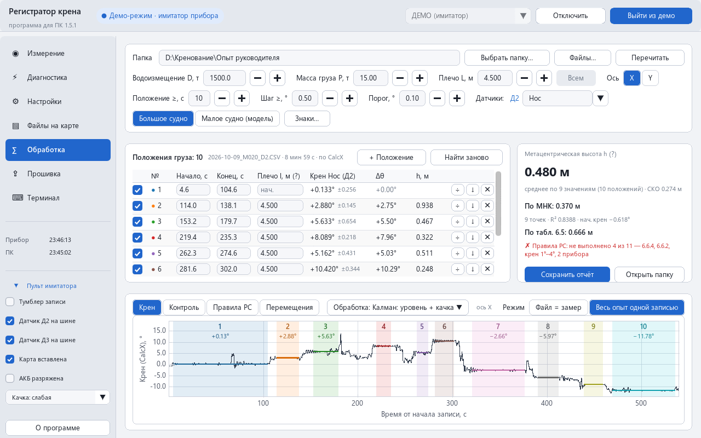
  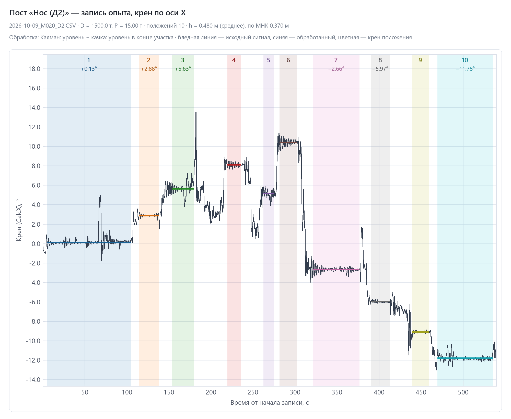
</p>

| № | начало–конец, с | длительность, с | крен CalcX, ° |
|---|---|---|---|
| 1 | 4,6–104,6 | 100,0 | +0,140 ± 0,256 |
| 2 | 114,0–138,1 | 24,1 | +2,880 ± 0,145 |
| 3 | 153,2–179,7 | 26,5 | +5,679 ± 0,654 |
| 4 | 219,4–235,3 | 15,9 | +8,089 ± 0,218 |
| 5 | 262,3–274,6 | 12,3 | +5,057 ± 0,431 (промежуточное — снять флажком) |
| 6 | 281,6–302,0 | 20,4 | +10,433 ± 0,344 |
| 7 | 321,1–376,6 | 55,5 | −2,663 ± 0,246 |
| 8 | 390,2–412,4 | 22,2 | −5,970 ± 0,105 |
| 9 | 438,9–459,5 | 20,6 | −9,094 ± 0,163 |
| 10 | 469,2–535,5 | 66,3 | −11,787 ± 0,244 |

Проверено и на синтетической записи «как у руководителя» (`tests/data/continuous`,
`tests/make_test_data.py`: 10 положений по 40–60 с, уровни 0, 3, 6, 8, 10,5, −2,5, −6,
−9,5, −12, 0,3°, качка и всплески, 10 Гц, OffsetX 2,701 / OffsetY −0,819 / BatV 11,6 —
**данные сгенерированы, это не настоящий файл**): найдены все 10 положений, уровни —
в пределах 0,05° от истинных.

### Крен положения: обработка сигнала

**Окно среднего (с 1.8)** — кнопка «Обработка: … ▼» → «Окно среднего», сохраняется в проекте:

| Режим | Что усредняется |
|---|---|
| **Весь диапазон** (по умолчанию) | весь выделенный диапазон положения без переходных начала и конца (крен ещё не успокоился после переноса или уже уходит к следующему — края определяются сами, на графике не закрашены) |
| Вторая половина | вторая половина установившегося крена, не короче 3·Tc (как 1.7.1) |
| 3·Tc в конце | окно статьи (13), как в 1.4–1.7 |
| Строго весь | весь выделенный диапазон без исключения краёв |

Так велят Правила: в Инструктивных указаниях по кренованию (прил. 3 к разд. 2 Руководства) крен замера по
инклинограмме — расстояние между осями колебаний соседних перебежек, а ось проводится через всю запись
перебежки (прил. 3-10 «Инклинограмма», прил. 3-13 «Хорошая инклинограмма и правильная её обработка»). Проверено на
синтетике с известными уровнями (`tests/data/continuous`) и на M020, M021, M024: по всему диапазону Калман ошибается
не больше 0,010°, медиана + EMA (fс 0,5 Гц) — 0,030°; «строго весь» — 0,034° / 0,053° (всплеск переноса в начале
участка). EMA с малым α (≈ 0,05, fс ≈ 0,08 Гц — как на MATLAB-графиках руководителя) красиво сглаживает, но
запаздывает: среднее по всему диапазону уходит на 0,2–0,6° на синтетике и до 1,5° на коротких положениях M021 —
поэтому fс оставлен 0,5 Гц статьи. Проект 1.7 / 1.7.1 открывается с прежним окном (тот же h).

**Подробнее** (с 1.8): щелчок по любой из четырёх карточек-показателей «Обработки» (h основной, второй расчёт и
МНК, Правила РС, вероятная ошибка) открывает окно с расписанным расчётом: формула, подстановка чисел, результат и
пункт Правил — по положениям / замерам (уровни, Δθ по приборам, h_i, h_k, σ, t_αn, вероятная ошибка, 6.6.1–6.6.5,
Δh, итог); закрывается ✕, Esc или щелчком мимо окна.

**Отчёт краткий / полный** (с 1.8): «Сохранить отчёт ▼» — «Краткий» (как раньше) или «Полный» — ещё лист **«Расчёт
по шагам»** сразу после «Протокола»: исходные данные → положения и уровни (метод, окно, параметры фильтра) → h от
начального и МНК → табл. 6.5 (ΔM, Δθ по приборам, h_i) → h_k → 6.6.1 (σ, 2σ, исключение) → 6.6.2 (t_αn, вероятная
ошибка, допуск) → 6.6.3 → 6.6.4 → 6.6.5 → поправка Δh → итог; каждый шаг — формула, подстановка, результат, пункт;
та же сетка и печать A4 (по ширине страницы). Выбор запоминается.

По умолчанию (с программы 1.4) крен положения считается **фильтром Калмана «уровень + качка»** — он лучший в
сравнении ниже. В списке методов (кнопка «Обработка: … ▼») есть и **метод статьи руководителя** «Математический
способ обработки углов крена при проведении опыта кренования» (Русановский С.А., Сковпень С.М.,
Музыка М.М., Платоненков С.В., МИТ, 2026), `src/core/Filters.hpp`:

- каскад: **медианный фильтр по трём последним отсчётам** (10) → **EMA**
  y[n] = α·yмед[n] + (1 − α)·y[n−1] (11), α = 2π·fс / (2π·fс + fоп) (12), fс = 0,5 Гц, fоп — частота
  опроса по записи (10 Гц → α ≈ 0,239; при 20 Гц, как в статье, — 0,136). Начальное значение EMA в
  статье не задано — первый отсчёт после медианы;
- **среднее — по обработанному сигналу на окне Ω** в конце положения (13) — там же статья считает размах (14) и
  дисперсию (15) критерия установившегося угла; Tc (период собственных колебаний) задаётся или берётся по записи
  (переходы через уровень). **С 1.7.1** окно Ω — **вторая половина установившегося крена, но не короче 3·Tc** статьи,
  а «установившийся крен» — участок без переходных начала и конца: с каждого края отбрасывается то, где скользящее
  среднее за период качки уходит от уровня второй половины больше max(0,05°; 3σ) (крен ещё не успокоился после
  переноса или уже уходит — груз начали переносить). До 1.7.1 окно было ровно 3·Tc в самом конце участка: у модели
  Tc ≈ 2 с — это 6 с, в них не усредняется медленное «гуляние» крена (биения, дрейф с периодом 10–20 с) и попадает
  начало следующего переноса — на опыте M024 линия среднего уходила от сигнала на 0,1–0,25° (положение 8 кормы:
  −4,842° при сигнале −4,97°; теперь −4,958°). Калман считает уровень по тому же окну (начиная с медианы окна), свой
  метод — по установившемуся крену (T0, T1 правила среднего — его начало и конец; пресет «статья» —
  `max(3*Tc, (T1 - T0)/2)`).

На графике (кнопка «Обработка: … ▼» над ним — метод и параметры, «Знаки…» — число знаков в полях):
бледная линия — исходный сигнал, синяя — обработанный, толстая цветная — среднее по обработанному
(окно Ω выделено), пунктир — оно же на всём положении. Щелчок по положению в таблице или на графике —
оно крупно справа. В отчёте — `Положения_Нос.png` (все положения сеткой) и в листе «Положения»
столбцы «Крен, среднее», «Крен по методу», «Окно метода».

<p align="center">
  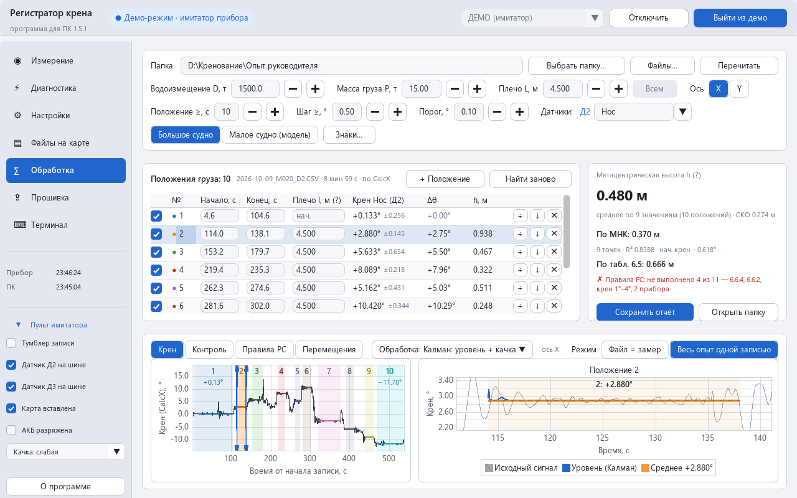
  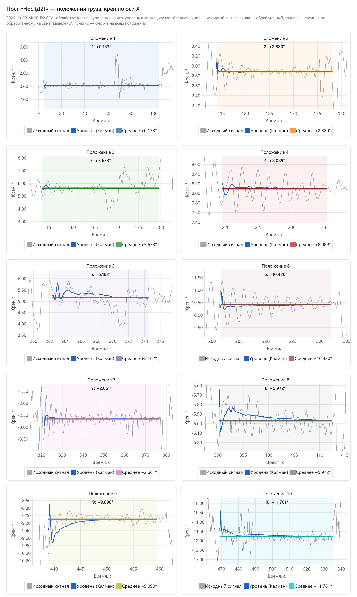
</p>

Другие методы (выбор там же): **простое среднее** (как было), **Савицкий–Голай** (полином 2-й
степени по окну 4 с, среднее — на Ω), **фильтр Калмана «уровень + качка»** (состояние: постоянный
уровень θ0 и затухающий осциллятор с частотой качки по данным; оценка — θ0 в конце положения),
**аппроксимация затухающей синусоидой** θ(t) = θ∞ + e^{−λt}(a·cos ωt + b·sin ωt) (МНК, выбросы —
вторым проходом; оценка — равновесный угол θ∞). Сравнение (`process_test`): |ошибка| — от истины
(синтетика), разброс — СКО оценок по соседним окнам 15 с внутри положения, «до ±0,02°» — сколько
секунд от начала положения нужно, чтобы оценка больше не уходила от итоговой дальше 0,02°:

| метод | синтетика, 1 положение ×5: ошибка / разброс / до ±0,02° | синтетическая запись, 10 положений | запись M020: разброс / до ±0,02° |
|---|---|---|---|
| Медиана + EMA (статья, окно Ω) | 0,093° / 0,181° / 57 с | 0,011° / 0,038° / 40 с | 0,091° / 35 с |
| Медиана + EMA, весь участок | 0,042° / 0,173° / 43 с | 0,016° / 0,039° / 20 с | 0,146° / 23 с |
| Простое среднее | 0,027° / 0,078° / 46 с | 0,017° / 0,041° / 23 с | 0,137° / 21 с |
| Савицкий–Голай | 0,072° / 0,201° / 57 с | 0,010° / 0,040° / 37 с | 0,072° / 34 с |
| **Калман: уровень + качка** | **0,011° / 0,030° / 33 с** | 0,005° / 0,013° / 21 с | **0,054° / 23 с** |
| Затухающая синусоида | 0,005° / 0,119° / 40 с | **0,005° / 0,003° / 10 с** | 0,111° / 23 с |

Медиана по трём отсчётам снимает только одиночные выбросы, EMA с fс = 0,5 Гц почти не трогает качку
(0,1–0,5 Гц), поэтому точность метода статьи определяет окно среднего Ω = 3·Tc: оно короткое, и
незатухшая качка в нём сдвигает среднее. Фильтр Калмана, который моделирует качку явно, на всех трёх
наборах точнее и устойчивее; синусоида лучшая на «чистой» затухающей качке, но хуже на настоящей записи
(качка там не одна синусоида).

### Свои методы обработки (формулы)

«Обработка: … ▼» → «Свои методы (формулы)…» — окно, где метод собирается из формул для апробации без сборки
программы (`src/core/Expr.hpp` — свой маленький интерпретатор без внешних библиотек и без исполнения кода,
`src/core/UserMethod.hpp` — метод из стадий). Метод — название, константы, **стадии** (выход одной — вход
следующей) с начальными значениями и **правило среднего**; в расчёте — вместе со встроенными методами; предпросмотр
на выбранном положении рядом с текущим методом (обе линии и оба средних); ошибки — с местом («Стадия 2, знак 7:
неизвестное имя «z»»); методы сохраняются (`%APPDATA%\Krenomer\methods`) и передаются файлом `.krenomer-method`
(«Экспорт…» / «Импорт…»). Готовые: «Медиана + EMA (статья)», «Простое среднее», «Пример из трёх стадий».

<p align="center">
  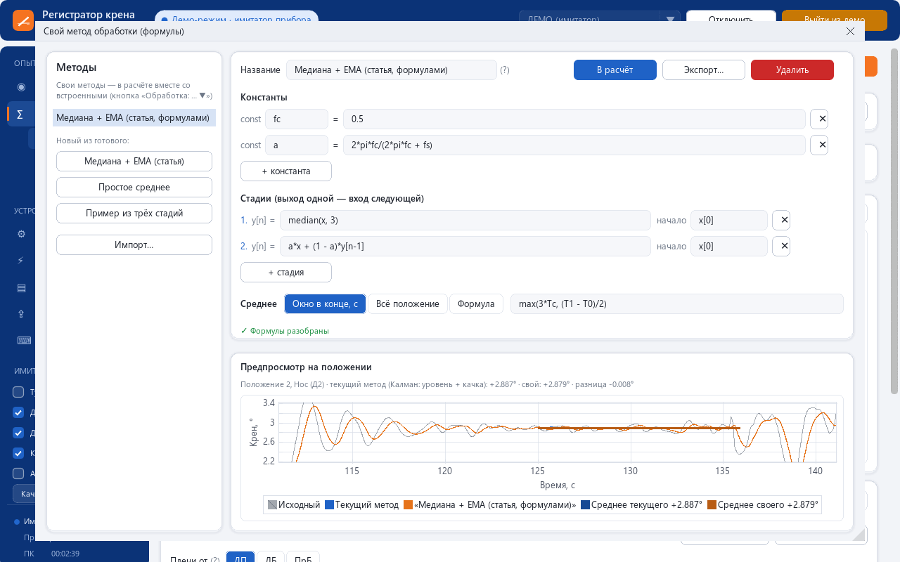
</p>

- Стадия: **y[n] = формула**; x — вход стадии (у первой — исходный крен), `x[n-k]`, `x[k]`, `y[n-k]` (k ≥ 1),
  `n`, `t` (с), `fs` (Гц), `dt` = 1/fs, `Tc` (период качки, с), `pi`, константы; `+ − * / ^`, скобки,
  `< <= > >= == !=`, `and or not`, `c ? a : b`, `if(c, a, b)`; `abs sqrt exp ln log10 sin cos tan atan atan2 pow
  min max mean floor ceil round sign clamp`; ряды по входу стадии `median(x, N)`, `sma(x, N)`, `ema(x, α)`.
- Среднее: «окно в конце» (последние T с положения), «всё положение» или формула с `avg()`, `avgw(T)`, `med()`,
  `medw(T)`, `last()`, `T0`, `T1`.
- Метод статьи формулами (совпадает со встроенным до 1e-9, тест):

  ```
  krenomer-method 1
  name = Медиана + EMA (статья, формулами)
  const fc = 0.5
  const a = 2*pi*fc/(2*pi*fc + fs)
  stage = median(x, 3)
  stage = a*x + (1 - a)*y[n-1]
  mean = window max(3*Tc, (T1 - T0)/2)
  ```
- Ограничения: формула — до 2000 знаков и 1000 элементов, вложенность до 64, стадий до 8, констант до 16;
  нечисловой результат (деление на 0) заменяется предыдущим значением, число замен показывается.

### Датчики и посты

Датчики заменяют вески: любой может стоять в носу, корме, на мидель-шпангоуте. «Датчики:» — у каждого найденного
датчика своё **название поста** (поле ввода; ▼ — «Нос», «Корма», «Мидель», «Нос, ЛБ», … и «Учитывать в расчёте»);
названия — в таблице, на графиках, в журнале, в отчёте и в именах картинок (`График_<пост>.png`), запоминаются.
Постов в замере / положении — до четырёх; у каждого свой крен, **расхождение между постами** считается (замер и
положение — `Spread()`), в отчёте при нескольких постах — лист «Сравнение постов» (крен каждого поста и
расхождение) — задел для сравнения датчиков между собой, как весков.

<p align="center">
  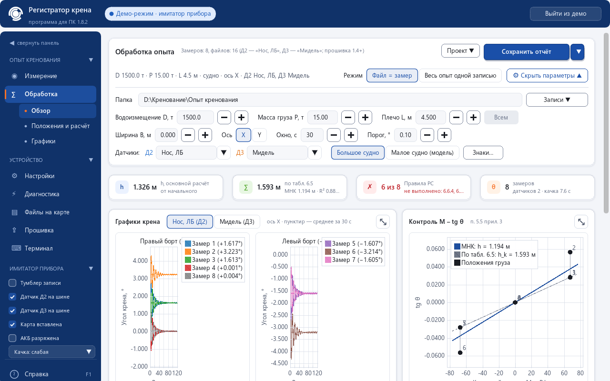
</p>

**Знак датчика.** Крен «+» — на правый борт: груз к ПрБ должен давать «+». Если датчик поставлен «задом
наперёд» (ось +X — к левому борту), в меню датчика (▼ у названия) — «Обратный знак»: углы его файлов (X и Y)
берутся с обратным знаком, сами файлы не меняются; выбор запоминается. Если плечи введены со знаком, а крен
положения — в другую сторону, чем перенос, точка «от начального» не учитывается с пояснением «крен в другую
сторону, чем перенос груза (знак датчика?)», а h_i табл. 6.5 выходят отрицательными.

### Большое и малое судно, знаки, правки положений

- **«Большое судно / Малое судно (модель)»** (после «Посты»): большое — D и P в тоннах, плечи в
  метрах; малое (модель, длина примерно до 5 м) — D и P в **килограммах**, плечи в **миллиметрах**
  (по умолчанию 50 кг, 1 кг, 200 мм), h — в метрах и ещё в мм. При переключении введённые числа
  переводятся в новые единицы; перевод в т и м — в расчёте (`Heel.hpp`, `heel::Units`), так что
  один опыт в т/м и в кг/мм даёт тот же h (тест). В отчёте и на картинках единицы указаны.
- **«Знаки…»** — знаков после запятой в полях D, P, плечи (не меньше 3), порог, шаг. Число хранится
  как введено; маленькое ненулевое число нулём не показывается (знаков — сколько нужно, до 6).
- **Плечи от ДП.** У начального положения (в таблице — «нач.») плечо можно не задавать: тогда плечи остальных —
  от начального, как раньше. Если задать (плечо груза от ДП, + к ПрБ), плечи всех положений вводятся от ДП (как
  меряют от борта: плечо = половина ширины − расстояние от ПрБ), а перенос считается разностью с начальным.
- **Ручные правки положений** (границы, флажки, плечи, добавленные и удалённые) сохраняются у
  программы (`%APPDATA%\Krenomer\edits`, ключ — имя, размер и время файла записи и ось) и
  восстанавливаются при следующем открытии; кнопка «Сбросить правки» их забывает.
- **Журнал**: файлы не того формата (чужие книги Excel и CSV в «Загрузках») — одной строкой
  «Пропущено N файлов не того формата», список — по наведению. В «Постах» файлы без номера датчика в
  имени — «прочие файлы» (список — по наведению).

<p align="center">
  
  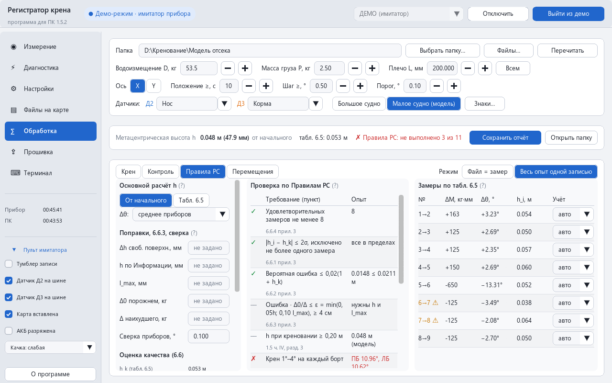
</p>
<p align="center">
  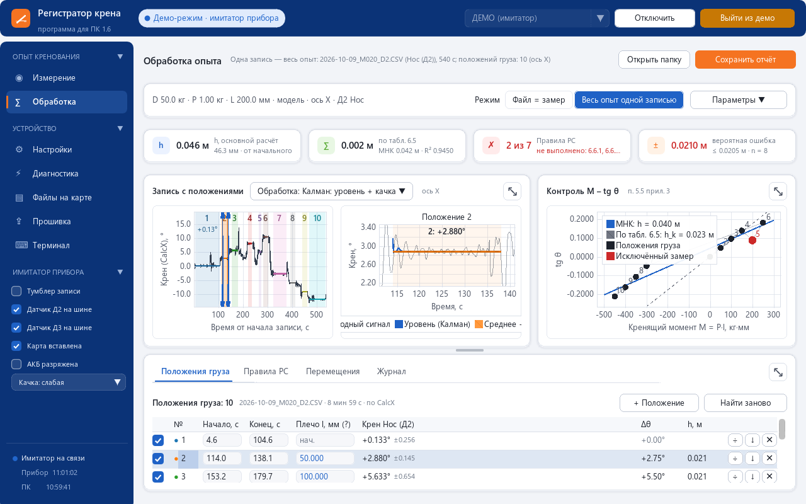
</p>

### Проверка по Правилам РС

По Правилам РС — Часть IV «Остойчивость», 1.5 (1.5.8, 1.5.9), и Инструктивные указания по кренованию
судов (приложение 3 к разд. 2 Руководства по техническому наблюдению за постройкой судов). Расчёт —
`core/RsCheck.hpp` (формулы и требования, без интерфейса), вход из данных «Обработки» —
`core/HeelRs.hpp`, экран — `ui/AppRules.cpp`. Тексты Правил в репозиторий не кладутся.

**Два расчёта h — рядом** (решение руководителя: показывать оба):

- **от начального положения + МНК** — как было: h по каждому положению (замеру) от начального,
  среднее и прямая МНК;
- **по приращениям, табл. 6.5**: замер i — переход между соседними положениями (по порядку опыта),
  ΔM_i = P·(l_i − l_{i−1}), Δθ_i = θ_i − θ_{i−1} (рад), h_i = ΔM_i / (Δ·Δθ_i); h_k = Σh_i / n.
  Крен положения — по основному посту (первый датчик с файлом), у «файл = замер» — замеры по номеру,
  и если у первого плечо не 0 — впереди условное начальное положение (крен 0, плечо 0).

Какой из них **основной** (крупно в карточке h, в проверке h ≥ 0,20 м) — переключатель «От начального |
Табл. 6.5» на вкладке «Правила РС» (по умолчанию: в режиме «Одна масса P» — «от начального», в режиме «Группы» —
табл. 6.5; выбор запоминается для каждого режима отдельно); второй всегда виден строкой ниже
(«По табл. 6.5: 0.800 м → 0.79» — стрелка, если сработал 6.6.5).

**Оценка качества (6.6):**

- **6.6.1** — |h_i − h_k| ≤ 2σ, σ = √(Σ(h_i − h_k)² / (n − 1)). **Автоисключение**: если вручную
  ничего не исключено, из не отвечающих условию исключается один — худший (наибольшее |h_i − h_k|),
  и h_k, σ считаются заново. Если и после этого есть замеры вне 2σ, или исключено больше одного —
  6.6.1 не выполнен. Вручную у каждого замера табл. 6.5: «авто / исключить / учитывать»: «исключить» —
  замер не в расчёте (автоисключение тогда не делается), «учитывать» — в расчёте, даже если вне 2σ.
  Переход без перемещения груза (ΔM = 0) — не замер, в n не входит.
- **6.6.2** — вероятная ошибка t_αn·√(Σ(h_i − h_k)² / (n(n − 1))) ≤ 0,02(1 + h_k) при h_k ≤ 2 м,
  ≤ 0,01(4 + h_k) при h_k > 2 м. t_αn — табл. 6.6.2 Инструктивных указаний (она же табл. 1.5.9.2
  Части IV), внесена как в документе:

  | n | 8 | 9 | 10 | 11 | 12 | 13 | 14 | 15 | 16 |
  |---|---|---|---|---|---|---|---|---|---|
  | t_αn | 5,4 | 5,0 | 4,8 | 4,6 | 4,5 | 4,3 | 4,2 | 4,1 | 4,0 |

  При n < 8 или n > 16 t_αn в таблице нет — сообщение «замеров 5 — меньше 8: t_αn по табл. 6.6.2 нет,
  вероятная ошибка не считается», 6.6.2 — ✗.
- **6.6.3** — вероятная ошибка · Δ0/Δ ≤ ε, ε = min(0,05h; 0,10 l_max) по наихудшему варианту загрузки,
  не менее 4 см. h, l_max и Δ0 (порожнем) — поля на вкладке «Правила РС», необязательные; без h и l_max —
  «нужны h и l_max» (—, не нарушение); без Δ0 — множитель 1.
- **6.6.4** — удовлетворительных замеров не менее 8.
- **6.6.5** — если 6.6.1, 6.6.2, 6.6.4 (и 6.6.3, когда задан) не выполнены — итог h_k минус вероятная
  ошибка, помечен «Итог (6.6.5) … = h_k − ошибка» (оранжевым) и в отчёте.

**Требования** (таблица ✓ / ✗ / — со ссылками на пункты): 6.6.1–6.6.4; h при креновании ≥ 0,20 м
(1.5 Ч. IV, у модели не проверяется); крен 1°–4° на каждый борт и начальный крен ≤ 0,5° (разд. 3);
возврат в ноль (п. 5.5: положение с креном у начального — не больше 10 % наибольшего и не меньше 0,2°;
нет возврата, но 6.6.1 выполнен — ✓ «прямая — можно не делать»); не менее 2 приборов (постов с
файлами); **сверка приборов** — на каждом замере расхождение **приращений** Δθ приборов (наибольшее −
наименьшее) ≤ порога: приборы стоят в разных местах и нули у них свои, поэтому сравниваются приращения, а не
уровни. Порог по умолчанию **0,1°** — десять шагов датчика (0,01°) и 3–5 % обычного приращения 2–3°
(меняется на вкладке «Правила РС»; замер с превышением помечен ⚠ в табл. 6.5 и в листе «Проверки»). На опыте с
весками (ниже) расхождение 0,055°, а ошибка переписи отсчётов веска (0,57°) ловится сразу. Итог одной
строкой — в карточке h («✗ Правила РС: не выполнено 2 из 11 — 6.6.4, 6.6.2»; щелчок открывает вид).

**Несколько приборов**: Δθ замера в табл. 6.5 — **среднее приращений всех приборов** (постов с файлами;
как в протоколах кренования — среднее весков) или приращение одного прибора (выбор «Δθ: среднее приборов /
по прибору …» на вкладке «Правила РС», по умолчанию среднее). Δθ и h_i по каждому прибору — на вкладке
«Перемещения» и в листе «Проверки».

**Кренящий момент**: режим «**Одна масса P**» — как раньше, плечо от начального положения у каждого
положения / замера; режим «**Группы**» (вкладка «Перемещения») — группы крен-балласта (название, масса в
единицах судна; хранятся в настройках) и таблица перемещений: на шаге i (переход положений / замеров
i → i + 1) — плечо перемещения каждой группы со знаком (+ к правому борту, 0 — не двигали),
ΔM_i = Σ m_g·l_ig (как в протоколе). Первое учтённое положение (замер) — начальное; для расчёта «от
начального» плечо положения — эквивалентное (накопленный момент / P, в таблице положений — серым). В
отчёте — лист **«Перемещения»** (группы, плечи по шагам, ΔM, накопленный момент).

**Поправки**: **Δh** — на свободные поверхности жидких грузов, h исправленная = h − Δh: в итоге (крупно, с
пометкой «испр. (−Δh)»), в основном расчёте, в проверке h ≥ 0,20 м и в листе «Проверки» («ИСПРАВЛЕННАЯ»).
**Δ наихудшего варианта** — для множителя Δ0/Δ в 6.6.3 (по умолчанию — D при креновании).

**Проверка на настоящем протоколе** (буксир, 2026, при инспекторе РС; в тест взяты только нужные расчёту
числа — `tests/VodnikData.hpp`): два веска как посты Д2/Д3, 11 замеров «файл = замер», 2 группы
(1,100 и 2,116 т) и 10 перемещений, D = 318,09 т, Δh = 0,031 м, Δ наихудшего 350,88 т, Δ0 290,23 т. Наш
расчёт без обходов: h_k = **1,154** м (протокол 1,154), исключён замер 2 (1,230), вероятная ошибка 0,0235 ≤
0,0431 (0,024 ≤ 0,043), исправленная h = **1,123** м (1,123). ε = 0,055 м (в протоколе по ошибке 0,04).

**Знак плеча**: плечо вводится **со знаком — «+» к правому борту** (подсказка «(?)» у столбца
«Плечо l»): табл. 6.5 считает по приращениям момента, ей нужен борт. Совместимость: если все плечи
положительные (ввод модулем, как раньше), борт берётся по знаку крена (у «от начального» — как было;
в табл. 6.5 — по знаку Δθ от начального, |Δθ| не больше порога — груз на месте, плечо 0), в журнале —
пометка один раз.

**График контроля** (п. 5.5): кренящий момент M = P·l (т·м, у модели кг·мм) — tg θ от начального;
точки — положения (номер), тонкая линия — порядок опыта, красная точка — конец исключённого замера,
прямая — МНК по остальным, пунктир — прямая по h_k табл. 6.5. **Период бортовой качки** Tc — по
переходам через медиану на каждом положении (`DominantOmega`), медиана и разброс — в сводке и в отчёте.

График контроля — своя карточка на «Обработке», «Правила РС» и «Перемещения» — вкладки нижней карточки (любую
карточку можно развернуть на всю область); итог проверки — карточка-показатель «Правила РС: n из m». В отчёте — лист
**«Проверки»** (оба h, сводка 6.6, требования ✓/✗/—, табл. 6.5 с исключёнными, Tc) после
«Результатов» / «Положений» и картинка **`График_контроля.png`**.

<p align="center">
  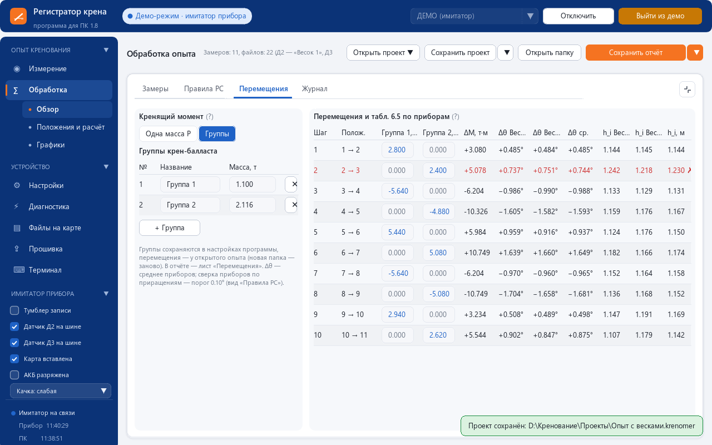
  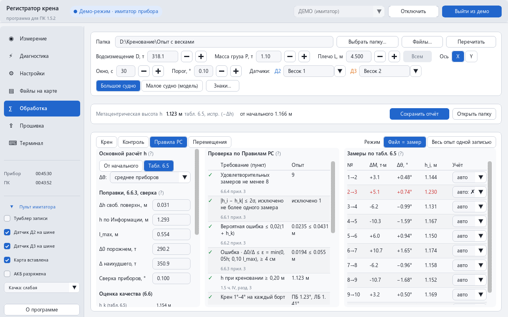
</p>
<p align="center">
  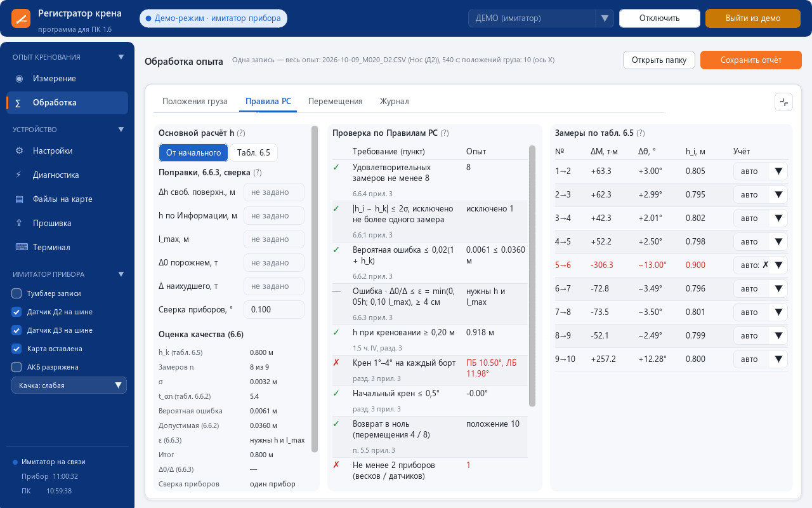
  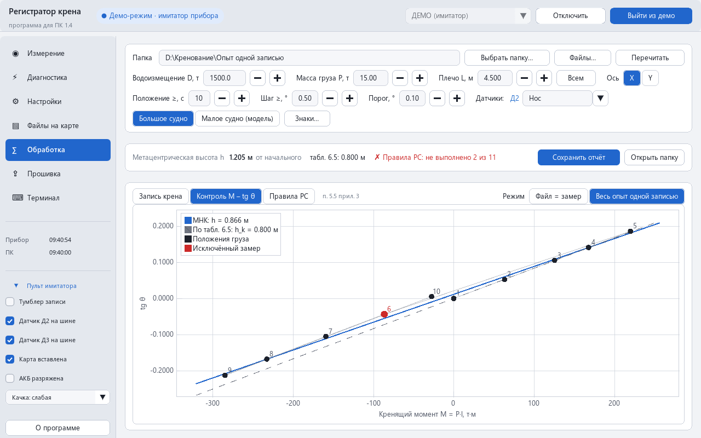
</p>
<p align="center">
  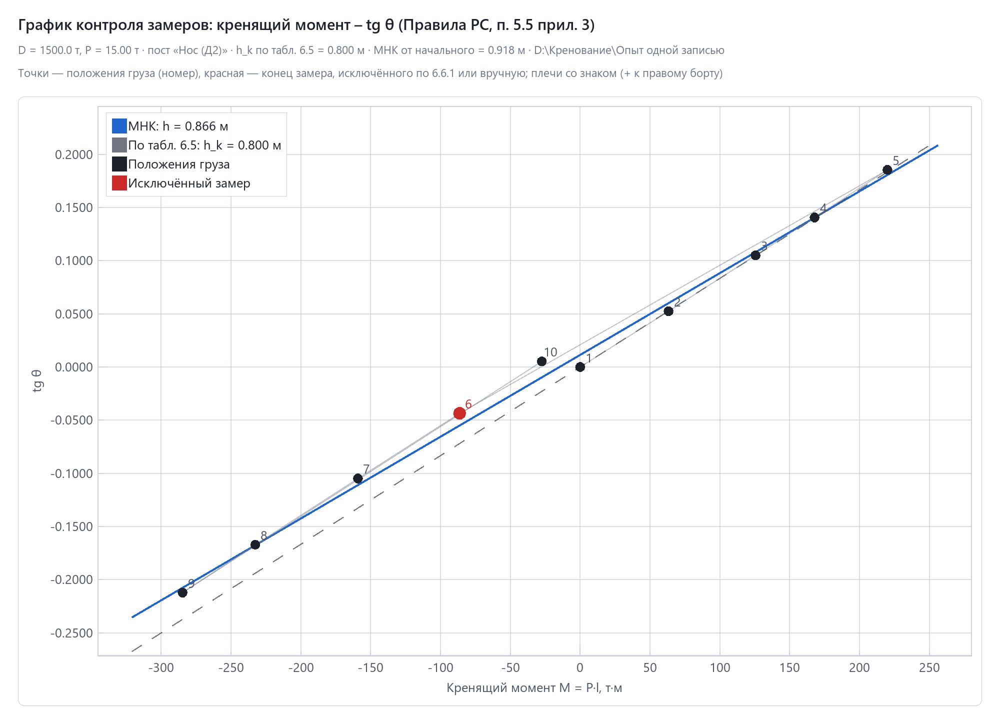
  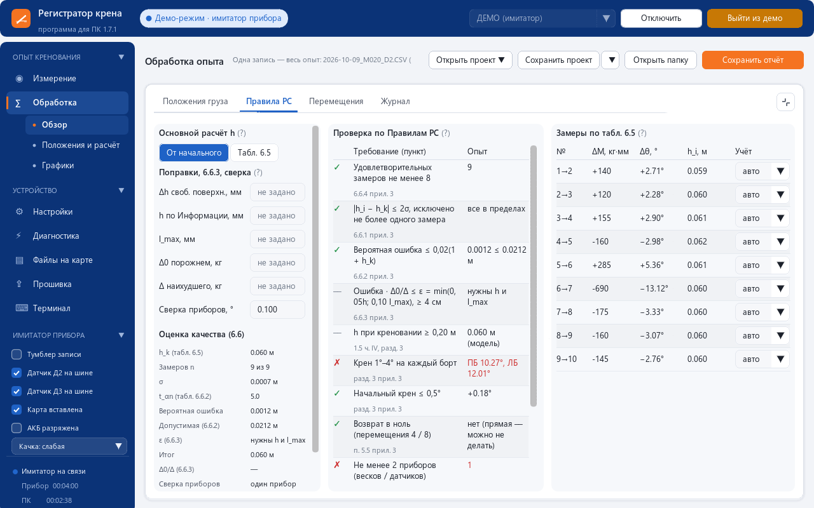
</p>
<p align="center"><sub>Синтетика (h = 0,8 м по табл. 6.5, перенос 5 записан на 12 % длиннее — замер 5→6
исключён по 6.6.1, h_k = 0.800 м; «от начального» эта ошибка сдвигает все следующие положения) и
запись руководителя M020 (плечей в записи нет — для снимка плечи со знаком, как записал бы оператор
у модели с h ≈ 60 мм).</sub></p>

### Отчёт: печатная форма

`Отчет_Кренование.xlsx` (с 1.5.2) — для печати и показа, без внешних библиотек (`core/Xlsx.hpp`: стили, рамки,
заливка, перенос, объединения, форматы чисел, печать, рисунки PNG; `core/HeelProtocol.hpp` — сборка):

- **«Протокол»** — первым листом: исходные данные (судно и единицы, дата и время опыта по файлам, D, P или группы
  крен-балласта, датчики с названиями и знаком, ось, режим, метод обработки, папка и файлы), положения / замеры
  (участок, плечо, крен по каждому датчику, среднее, ± СКО, Δθ, h), табл. 6.5 (ΔM, Δθ по приборам и среднее, h_i,
  учёт), проверки по Правилам РС ✓ / ✗ / — со ссылками на пункты, итог h (оба расчёта, основной выделен, поправка
  Δh, вероятная ошибка, период качки) и картинками — график контроля и запись с положениями;
- **«Графики»** — все картинки обработки (те же, что PNG-файлами рядом);
- «Положения» / «Результаты», «Проверки» (табл. 6.5 с h_i по каждому прибору), «Перемещения», «Сырые_данные»,
  «Сравнение постов» — в той же сетке.

Единая сетка: **все столбцы всех листов одной ширины**, длинный текст — в объединённых ячейках с переносом (высота
строки — по длине текста), числа с фиксированными знаками (углы `+0.000°`, h и моменты `0.000`), рамки таблиц,
заливка шапок, закреплённая верхняя строка; печать — A4 по ширине страницы (широкие таблицы — альбомная), повтор
строки шапки на каждой странице, номер страницы в колонтитуле. **«Сырые_данные» в печать не включаются**: в Excel нет
флага «не печатать лист», поэтому у листа сверху строка-пояснение, и область печати (`_xlnm.Print_Area`) — только
она: при «Напечатать всю книгу» лист занимает одну страницу с пояснением. Проверено: openpyxl, Excel (открытие скрыто через
COM, без «восстановления», экспорт в PDF).

<p align="center">
  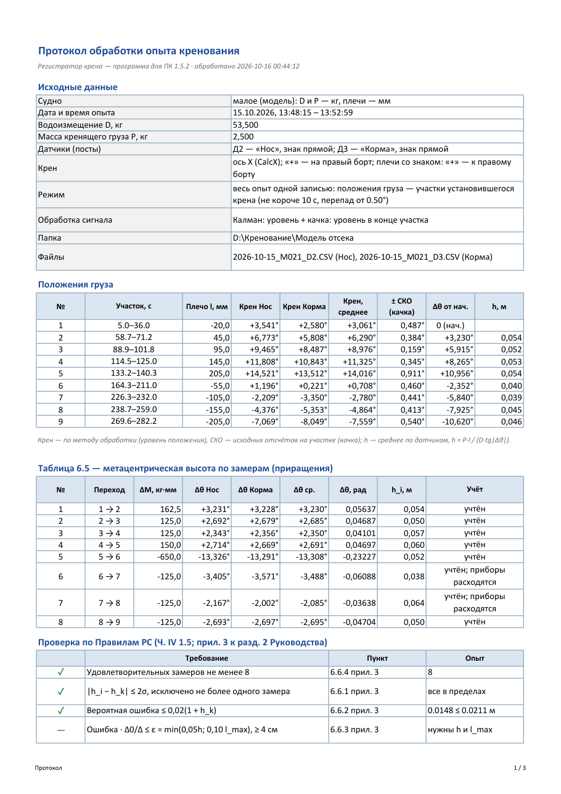
</p>

## Сборка

Тот же набор, что у ShagomerPCModule: C++23, CMake ≥ 3.24 + Ninja, зависимости из
vcpkg (манифест `vcpkg.json`: Dear ImGui с FreeType и привязками GLFW/OpenGL 2/3,
ImPlot, GLFW, CSerialPort, FreeType), статический CRT, тулсет **MSVC v143
14.44** (статическая STL тулсета v145 тянет функции Windows 8+, и `.exe` не
запускается на Windows 7).

Нужны Visual Studio 2022/2026 с компонентом «MSVC v143 - VS 2022 C++ x64/x86 build
tools (14.44)», vcpkg (`VCPKG_ROOT`, по умолчанию `C:\vcpkg`):

```bat
pc\build-win7.cmd                          rem build-win7\krenomer.exe (x64)
pc\build-win7-x86.cmd                      rem build-win7-x86\krenomer.exe (x86, 32 бита)
pc\build-win7.cmd -DKRENOMER_BUILD_TESTS=ON rem + тесты и стенд снимков
```

Скрипт вызывает `VsDevCmd.bat -vcvars_ver=14.44`, `cmake --preset default` (или
`win7-x86`) и сборку. После сборки `cmake/CheckWin7Imports.cmake` (из
ShagomerPCModule) проверяет таблицу импорта: функция Windows 8+ или DLL вида
`api-ms-win-*` — ошибка сборки, `.exe` удаляется. Пресет `win10` — без этой
проверки, любым тулсетом. Первая сборка ставит зависимости vcpkg (несколько
минут; со статическим триплетом `x64-windows-static-v143` из `triplets/`, как у
Шагомера, — значит, общий двоичный кэш vcpkg).

Результат (Release): `build-win7\krenomer.exe` — 4 564 480 байт (≈4,4 МБ; из них
запасные шрифты DejaVu ~1,8 МБ — ресурсами), 32-битный `build-win7-x86\krenomer.exe` —
4 244 480 байт.

Шрифт интерфейса — системный Segoe UI (обычный, Semibold, Bold) и Consolas в
терминале из `%WINDIR%\Fonts` (есть в Windows 7 и новее), растеризация FreeType с
лёгким хинтингом. Встроенные DejaVu — запасной вариант (если системного шрифта
нет или задана переменная окружения `KRENOMER_EMBEDDED_FONTS=1`) и источник
знаков, которых нет в Segoe UI. Чекбоксы и кнопки — свои (`ui::Checkbox`,
`ui::Button`, поле со шагом `ui::InputIntStep` / `InputDoubleStep` с кнопками
«−» / «+»). Импорт — только системные DLL Windows 7 (`OPENGL32`,
`SETUPAPI`, `ole32`, `SHELL32`, `COMDLG32`, `ADVAPI32`, `KERNEL32`, `USER32`,
`GDI32`, `IMM32`).

## Устройство программы

```
src/
  main.cpp                 один экземпляр, COM (окна выбора файла), RunUi()
  core/                    без интерфейса и Windows-окон
    Protocol.hpp           строки ответа (OK/ERR/DFU…), поток stream по именам колонок, status (JSON), ver, files,
                           пределы настроек
    Json.hpp, Codec.hpp    мини-разборщик JSON; base64, CRC-32
    Download.hpp           приём файла get (G/D/E) -> <папка>/<имя>.part -> проверка -> <имя>
    PcRecorder.hpp         запись на ПК: строки R -> CSV по датчикам (формат карты), Ms, пропуски, книга .xlsx
    CsvLog.hpp             файлы замеров всех прошивок и после Excel: формат по содержимому, столбцы по именам, время
    Heel.hpp               расчёт опыта кренования: h = P·l/(D·tg|θ|), порог, итог, МНК, Δθ от начального положения
                           (формулы — отдельно)
    Filters.hpp            крен положения: Калман (по умолчанию), медиана + EMA (статья), Савицкий–Голай, синусоида
    Expr.hpp               свой интерпретатор формул (без внешних библиотек и исполнения кода)
    UserMethod.hpp         свой метод из формул: константы, стадии, правило среднего, файл .krenomer-method
    Plateaus.hpp           положения груза в непрерывной записи: медиана, бинарная сегментация, устоявшиеся участки
    HeelData.hpp           «Обработка»: файлы папки -> замеры и посты, крен за окно, положения записи; HeelReport.hpp —
                           отчёт .xlsx
    Xlsx.hpp, Png.hpp      книга Excel и PNG без библиотек; Deflate.hpp — сжатие для обоих и распаковка
    XlsxRead.hpp           чтение книги .xlsx (ZIP, листы, общие строки, даты Excel) -> текст CSV для CsvLog.hpp
    History.hpp            кольцо отсчётов для графиков (15 000: 10 мин при 25 Гц)
    PcSettings.hpp         krenomer.ini;  TextUtil.hpp — UTF-8/UTF-16, байты, длительности, углы
  comm/
    Connection.hpp         канал до прибора: SerialConnection (COM, CSerialPort), SimConnection (имитатор),
                           NullConnection (стенд снимков)
    SerialConnection.hpp   поиск портов 0483:5740 (SetupAPI через CSerialPort), hot-plug, переоткрытие
    SimDevice.hpp          прибор-имитатор: тот же протокол, что прошивка (usb_cli.c + usb_cli_ext.c)
    DeviceLink.hpp/.cpp    очередь команд, ответы, таймауты, проверка ver, поток, опрос status, история, журнал
  fw/
    Firmware.hpp           проверка образа, поиск dfu-util, USB DFU (SetupAPI), шаги обновления (Updater)
    Process.hpp            запуск dfu-util без окна, вывод по строкам
  ui/
    Renderer.cpp           GLFW + OpenGL 3 / 2, DPI, цикл кадров (как у Шагомера)
    App.hpp, App*.cpp      шапка, меню, страницы; Theme / Fonts / Widgets / Dialogs
    Offscreen.hpp          кадр ImGui без окна -> картинка (графики «Обработки» в PNG)
```

**Потоки.** Интерфейс никогда не ждёт порт: `DeviceLink::Send()` только ставит
команду в очередь и возвращает `Request`, готовность (`done`) интерфейс проверяет в
следующих кадрах. Поток связи (`DeviceLink::Run`, шаг ~5 мс) открывает порт,
отправляет команды по одной, собирает строки ответа до `OK…`/`ERR…` (строки потока
`S,…` и шапка `# S,…` разбираются в любой момент, хоть посреди ответа), следит за
таймаутами, раз в секунду опрашивает `status`, перезапускает поток, если он
замолчал. Байты из порта принимает поток CSerialPort и режет на строки
(`LineSplitter`: куски USB по 64 байта, `\r\n`). Скачивание и перепрошивка —
автоматы, их двигает `App::Tick()` в каждом проходе цикла окна, и при свёрнутом
окне тоже; dfu-util работает отдельным процессом, его вывод читает свой поток.

**Подключение.** Порт с VID:PID 0483:5740 (или выбранный вручную) открывается с
DTR = 1; через 200 мс — `ver` (до трёх попыток по 1 с). Ответ «BWM427…» — это
прибор: `stream 100` и `status` (идёт запись на ПК — и `samples on`). Ответил что-то другое — чужое устройство ST с тем
же VID:PID: порт закрывается и больше не трогается до переподключения его к USB
(или до «Подключить»); промолчал — ещё одна попытка через 30 с. Три команды подряд
без ответа — порт переоткрывается; порт пропал (выдернули, `boot`, `reset`) — поиск
раз в секунду, прибор подхватывается сам.

## Протокол с прибором

Командная строка прибора описана в [README прошивки](../README.md#командная-строка-по-usb);
программа использует:

| Команда | Зачем |
|---|---|
| `ver` | проверка, что на порту регистратор, версия и сборка прошивки |
| `stream N` | углы для карточек и графиков (по умолчанию каждые 100 мс; на время скачивания — 500 мс); колонки — по именам из шапки `# S,…`, новые колонки в конце не мешают, без шапки — шапка прошивки 1.3 |
| `status` | раз в секунду: всё остальное (одна строка JSON, поля — [README прошивки](../README.md#командная-строка-по-usb)); на время смены адреса — каждые 300 мс |
| `set freq/alpha/gap/rollwin/rollhz/rollcalm/rollhyst/batalarm/theme` | «Настройки» |
| `set time ГГГГ-ММ-ДД ЧЧ:ММ:СС` | «Синхронизировать время с ПК» (местное время ПК) |
| `addr OLD NEW` | смена адреса; итог — `svc` в `status` |
| `zero`, `zero reset` | ноль |
| `diag`, `diag reset` | «Диагностика» |
| `files`, `get <имя>`, `get abort` | «Файлы на карте» |
| `boot` / `boot force` | «Прошивка» (переход в загрузчик) |
| `samples on` / `samples off` | «Запись на ПК» (с прошивки 1.5): ответ `OK samples on, dropped N`; пока включено, после каждого цикла опроса — строка `R,<адрес>,<n>,<t_ms>,<RawX>,<RawY>,<OffsetX>,<OffsetY>,<BatV>` на каждый свежий отсчёт, все числа целые (`n` — номер ответа датчика, `t_ms` — часы прибора, углы в сотых градуса, ноль в тысячных, АКБ в десятых вольта): `R,2,1234,567890,-46,-17,-458,0,118`. Строки R, как и S, разбираются в любой момент, хоть посреди ответа на другую команду, и в журнал терминала не пишутся (до 50 в секунду). Включается снова после каждого подключения; прошивке до 1.5 (по `ver` или ответу `ERR unknown command`) не отправляется |

Пределы настроек — как в прошивке: частота 1…50 Гц, α 0,01…0,99, пауза шины
2…100 мс, окно качки 10…60 с, отсчётов 2…5 в секунду, порог покоя 0,10…10,0°,
гистерезис 0…2,0°, порог АКБ 5…30 В (`src/core/Protocol.hpp`, `proto::limits`).
Значение вне пределов программа не отправляет (прибор и сам ограничивает).

**Скачивание файла.** На время скачивания опрос `status` останавливается, а поток
углов замедляется до 500 мс (строки `D` идут быстрее, графики живут). `get <имя>`
→ `G,<имя>,<размер>,0`, строки `D,<base64>` пишутся в `<имя>.part`, по `E,<байт>,<crc32>`
сверяются число байт и CRC-32 всего файла; совпало — `.part` переименовывается в
`<имя>`, нет — удаляется, и файл скачивается заново целиком (до двух повторов при
потере связи или несовпадении). Таймаут — 6 с без новых строк. Отмена — `get abort`
вне очереди.

**Перепрошивка** — как `tools/flash/dfu_flash.cmd`:
```
dfu-util -d 0483:df11 -a 0 -s 0x08000000 -D image.bin                 запись
dfu-util -d 0483:df11 -a 0 -s 0x08000000:<размер> -U readback.bin     чтение обратно + сравнение
dfu-util -d 0483:df11 -a 0 -s 0x08000000:4:leave -U leave.bin         запуск прошивки
```
Образ копируется во временную папку (короткий путь — dfu-util не понимает
кириллицу вне кодовой страницы). Сектор 7 (настройки прибора) не стирается.

## Тесты и снимки экрана

```bat
pc\build-win7.cmd -DKRENOMER_BUILD_TESTS=ON
ctest --test-dir pc\build-win7 --output-on-failure
pc\build-win7\ui_shots.exe --out shots
```

| Тест | Что проверяет |
|---|---|
| `protocol_test` (261 проверка) | строки ответа и `LineSplitter` (куски по 7 байт); поток: шапка, колонки по именам, новые колонки в конце, старая прошивка без колонок шины, без шапки; разборщик JSON; `status` — образец из host-теста прошивки (`tests/data/status_fw.json` = `build_host/status_sample.json`), новые поля, не-JSON; `ver` (с номером версии и без); `files` (запятые в имени, старые имена `M_NNN_k`); base64 и CRC-32; приём файла: успех, порченый байт, нет `E`, `ERR` посреди, мусор, кириллица в пути; тексты; строки R `samples` (пределы, новые поля в конце, мусор), ответ `samples`, сравнение версий (1.5 / 1.4.1 / без номера); строка CSV записи на ПК — против примеров прошивки (host-тест `sd_format_row`, README), разбор обратно, имена файлов и метка |
| `link_test` (157) | `DeviceLink` с имитатором в модельном времени и в реальном (поток связи, 20 команд из «интерфейса»): подключение, частота потока, история, опрос; `set`, `set time`, `zero`, `diag`; `files` и скачивание двух файлов (сравнение с содержимым имитатора), поток при скачивании, отмена посреди передачи, нет файла; запись (отказы `files`/`boot`/`addr`, прерванная передача); `reset` и `boot` → DFU → снова на связи (новая версия); смена адреса и `svc`; чужой порт (ответил не BWM427 / молчит), зависший прибор → переоткрытие; подключение, пока прибор досылает чужую передачу (хвост D/E и лишний OK до ответа на ver, затем `get abort`); строки потока посреди ответа; `samples`: строки R в очередь (номера подряд, без записи в журнал), `samples on` снова после переподключения и после `samples off` из терминала, прошивка 1.4 (не отправляется, вручную — `ERR unknown command`), версия без номера (одна попытка), строки R посреди ответа; запись на ПК (`pcrec::Recorder`): CSV по датчикам, ноль посреди записи, сброс в файл раз в секунду, выброшенные прибором строки и обрыв связи → «потеряно», перезагрузка прибора (Ms не идёт назад), книга .xlsx, без перезаписи (« (2)») |
| `firmware_test` (35) | проверка образа (синтетические и настоящий `.bin` из сборки прошивки, если она есть); прогресс dfu-util; обновление с имитатором целиком; отказ при записи и `boot force`; плохой образ; запуск процесса (вывод, код выхода), поиск dfu-util |
| `process_test` (783) | «Обработка»: файлы 1.4+ (настоящие файлы прибора `tests/data/2026-10-08_M019_D2/D3.CSV` — значения и среднее/СКО за окно против посчитанных отдельно), «-0,000», CRLF, BOM, оборванная строка; до 1.3 с `Ms` и без (время по `Time`, строки секунды равномерно), старый анализатор (через полночь), без `Calc`; папка с кириллицей: замеры по номеру, посты по умолчанию и смена, два датчика на посту, записи на ПК; h против посчитанного вручную, порог, «не в расчёте»; МНК: h = 0,8 м точно, и при начальном крене (среднее смещено, МНК — нет), прямая через ноль, шум; отчёт: листы, строки, итог, МНК, сырые данные, ZIP (части, сжатие); старые форматы (`tests/data/old`: исходная прошивка `M_NNN.CSV` / `M_NNN_k.CSV`, 1.0–1.3, без шапки, выдернутая карта с нулями, анализатор, Excel «;» + запятая + BOM + `sep=;` + `Time` без секунд, UTF-16 с табуляцией, «не понял формат») — формат, строки, среднее против посчитанного отдельно, группировка по именам, другие имена — отдельные записи, подпапки; положения груза (`Plateaus.hpp`): ступеньки с качкой и всплесками, слияние близких, короткие, синтетическая запись «как у руководителя» (`tests/data/continuous`) — 10 положений, уровни ±0,1° от истины, участки внутри ступенек; Δθ от начального, h по положениям, МНК h = 0,8 м; режим по содержимому, отчёт «Положения»; книги .xlsx как источник: своя (`Xlsx.hpp`, со сжатием и без), как пишет Excel (`tests/data/xlsx/excel_100.xlsx` — часть книги руководителя: общие строки, Date/Time числами-датами, deflate со своими кодами), openpyxl (данные на втором листе, inlineStr), испорченная книга, `Inflate` (обратно `Compress`, блок без сжатия, оборванный поток), отбор книг в папке, имя книги группируется как CSV; настоящая запись руководителя (`tests/data/real`) — 10 положений, уровни ±0,1°, СКО < 0,7°, всплески 181/380/436 с вне положений; обработка сигнала положения (`Filters.hpp`): медиана и EMA по статье, α по (12), окно Ω = 3·Tc, Савицкий–Голай, Калман, затухающая синусоида, сравнение методов на синтетике и записи M020; малое судно: тот же h в т/м и кг/мм, единицы в отчёте; правки положений: сохранение, чтение в других единицах, сброс; формулы (`Expr.hpp`): разбор, приоритеты, функции, ошибки с позицией, ограничения длины и сложности; свои методы (`UserMethod.hpp`): текст метода, ошибки с местом, пресет «статья» формулами = встроенный метод до 1e-9, нечисловые значения, несколько стадий и среднее формулой; посты: лист «Сравнение постов», расхождение; настройки: ось по умолчанию X, выбор сохраняется, ось из файла 1.2 не берётся, судно, знаки, метод; Правила РС (`RsCheck.hpp`, `HeelRs.hpp`): t_αn по табл. 6.6.2 (n = 8…16, вне — нет), h_i по табл. 6.5 = 0,8 м точно, h_k, σ, вероятная ошибка против посчитанной отдельно, требования; замер с ошибкой 12 % исключается автоматически (один), ручное «учитывать» → 6.6.5 (h_k − ошибка), ручное «исключить» — без автоисключения; n < 8, h_k > 2 м (допуск 0,01(4 + h_k)), ΔM = 0, нет l_max / h (6.6.3 «нет данных»), ε не менее 4 см, Δ0/Δ; плечи со знаком = модулем со знаком по крену (`Solve`); на синтетической записи — 9 замеров, исключён 5-й, h_k = 0,8 м, график контроля, Tc, лист «Проверки», т/м = кг/мм; настоящий протокол кренования (`tests/VodnikData.hpp`: два веска, группы крен-балласта, Δh, Δ наихудшего) через файлы «файл = замер» — h_k 1,154, исключён замер 2, ошибка 0,024 ≤ 0,043, исправленная 1,123, ε 0,0554, сверка приборов (и ошибка переписи веска — 0,57°), один прибор — другой итог, листы «Проверки» (столбцы по приборам) и «Перемещения», группы в настройках; опыт на модели отсека (`tests/data/m021`, только Ms, CalcX, CalcY): два датчика, 9 положений (2 коротких — вручную), плечи от ДП = от начального, h от начального ≈ 0,048 м и по МНК ≈ 0,049 м, табл. 6.5 h_k ≈ 0,053 м (n = 8, ошибка 0,015 ≤ 0,021), крен ±11° — не 1°–4°, обратный знак датчика (ApplyInvert): оба — крен против переноса, один — приборы расходятся; отчёт в печатной форме (`HeelProtocol.hpp`): листы и их порядок, картинки в книге (части `xl/drawings`, `xl/media`, связи, якоря), объединения, печать (A4, по ширине, повтор шапки — `_xlnm.Print_Titles`), стили (заливка, рамки, перенос, формат углов), единая ширина столбцов, прежние номера стилей; deflate и PNG — распаковка тестовым inflate |
| `ui_shots` (222) | весь интерфейс без окна и видеокарты: 62 снимка (с макетами предложений по Правилам РС) (растеризация ImDrawData в PNG — из стенда `ui_smoke` Шагомера) на 1280×800 и 1024×700 и проверки: нигде нет горизонтальной прокрутки, основные страницы помещаются без вертикальной, индексы отрисовки в пределах, кадр не пустой, файлы реально скачались, запись на ПК (демо, обрыв связи посреди) — два CSV и книга `.xlsx`; «Обработка» по 8 синтетическим замерам (h = 0,8 м): чтение в фоне, h и МНК, отчёт и две картинки графиков сохранены; весь опыт одной записью (синтетика `tests/data/continuous`): режим выбран сам, ось X, 10 положений, h по МНК ≈ 0,8 м, отчёт и картинка записи; старые файлы — все поняты; настоящая запись руководителя — 10 положений, положение крупно (исходный, обработанный, среднее), картинка положений, малое судно; Правила РС: синтетика с ошибкой 12 % (замер 5 исключён, h_k ≈ 0,8 м) — вид «Правила РС» (1280×800, 1024×700, тёмная тема), график контроля, лист «Проверки» и `График_контроля.png` в отчёте; запись M020 — большое судно (плечи = L, без знака) и модель (плечи со знаком); опыт с двумя весками (протокол): группы и перемещения, h_k 1,154 → исправленная 1,123, виды «Перемещения» и «Правила РС», отчёт; модель отсека M021 (малое судно, два датчика, 9 положений, плечи от ДП) — вид положений, «Правила РС», график контроля, отчёт |

Снимки (в `--out`): `00_not_connected`, `01_measure`, `02_measure_calm`,
`03_measure_recording`, `04_measure_10min`, `05_measure_dark`,
`06_measure_1024x700`, `06_settings_1024x700`, `06_files_1024x700`, `07_diag`,
`07_diag_text`, `08_settings_addr_progress`, `09_settings`, `10_files_download`,
`11_files_done`, `12_firmware_progress`, `13_firmware_done`, `14_terminal`,
`15_about`, `16_measure_pc_old_fw` (прошивка 1.4: запись на ПК недоступна),
`16_measure_pc_nolink`, `16_measure_pc_recording`, `16_measure_pc_recording_dark`,
`16_measure_pc_recording_1024x700`, `17_measure_pc_done` (CSV и `.xlsx` записи
остаются в `%TEMP%\Записи на ПК`; папку стенда задаёт переменная `KRENOMER_SHOTS_DIR`), `18_process`, `18_process_dark`,
`18_process_1024x700`, `18_process_saved` и сохранённые «Обработкой»
`18_process_export_bow.png`, `18_process_export_stern.png`,
`18_process_report.xlsx` (файлы замеров — в `%TEMP%\Опыт кренования`),
`19_process_continuous`, `19_process_continuous_dark`, `19_process_continuous_1024x700`,
`19_process_continuous_export.png`, `19_process_continuous_report.xlsx` (весь опыт одной
записью — `%TEMP%\Опыт одной записью`), `20_process_old_files` (старые форматы —
`%TEMP%\Старые файлы`), `21_process_real`, `21_process_real_export.png` (настоящая запись
руководителя — `%TEMP%\Опыт руководителя`). Выборка — в `docs/img/`. Пути на снимках и в отчётах стенда
подменяются (`App::SetShownPaths`): папка стенда и `%TEMP%` показываются как
`D:\Кренование\…` (корень — переменная `KRENOMER_SHOTS_SHOW_DIR`), исходники, профиль
пользователя и `%APPDATA%` — подпапками там же; файлы пишутся по настоящим путям. В
программе подмены нет.

## Ограничения и что дальше

- **С настоящим прибором сама программа ещё не запускалась** (ноутбук прибора
  управляется удалённо, окна там не открыть): протокол проверен host-тестами
  прошивки (`tests/host`, в том числе образец JSON прошивки — в тестах программы),
  имитатором и юнит-тестами, а команды, которыми пользуется программа, — на
  приборе вручную (08.10.2026: `files`/`get` — файл 1,5 МБ за 4,6 с с прошивкой
  1.4.1+, `samples` — 10 с при 10 Гц, по 101 строке R от Д2 и Д3 без пропусков,
  `dropped 0`). При первом подключении программы проверить: находится ли порт,
  частота потока, скачивание, перепрошивку с WinUSB на Windows 7.
- VID:PID 0483:5740 общий для устройств ST: на чужой такой порт программа
  отправит `ver` (один раз; промолчавшему — ещё раз через 30 с) и оставит его в
  покое.
- Скачивание после обрыва начинается заново (прошивка умеет `get <имя> <смещение>`,
  программа его пока не использует — так каждый файл целиком проверен одной CRC).
- «Обработка»: формулы «от начального» — как в исходной программе (см. выше), рядом — табл. 6.5
  Правил РС; какой расчёт официальный — решает руководитель (переключатель «основной расчёт»);
  отчёт собирается в памяти — лист «Сырые_данные» не больше 300 000 строк (дальше
  — сообщение в журнале, «Результаты» полные).
- Запись на ПК (`samples`) целиком проверена имитатором и host-тестами прошивки;
  на приборе 1.5 проверен сам поток строк R (см. выше), но не вместе с программой:
  проверить частоту строк R при 2 × 16 Гц и счётчик `dropped` (ответ `samples`)
  при одновременном потоке и `status`.
  `Date`/`Time` в файлах ПК — часы ПК с точностью до секунды.
- Масштаб под DPI берётся при запуске (перетаскивание окна на монитор с другим DPI
  не перестраивает шрифты).
- `set time` ставит местное время ПК с точностью до секунды.

## Лицензии

Свой код — как у всего репозитория. Сторонние компоненты (в `.exe` статически):
Dear ImGui и ImPlot — MIT; GLFW — zlib/libpng; FreeType — FreeType License;
CSerialPort 4.3 — LGPL-3.0 с исключением для статической линковки; запасные шрифты
DejaVu Sans / Sans Bold / Sans Mono 2.35 — лицензия Bitstream Vera / DejaVu
(`assets/fonts/LICENSE_DEJAVU.txt`); системные шрифты Windows (Segoe UI, Consolas)
в программу не входят — читаются из системы. dfu-util (GPL-2.0) — отдельная программа, в
`krenomer.exe` не входит. Сборочные скрипты, проверка импортов Windows 7, растеризатор
снимков, запись PNG и `TestUtil.hpp` — из ShagomerPCModule (тот же автор). «Обработка» —
по мотивам BWM427_Analyzer (Romero2207).
