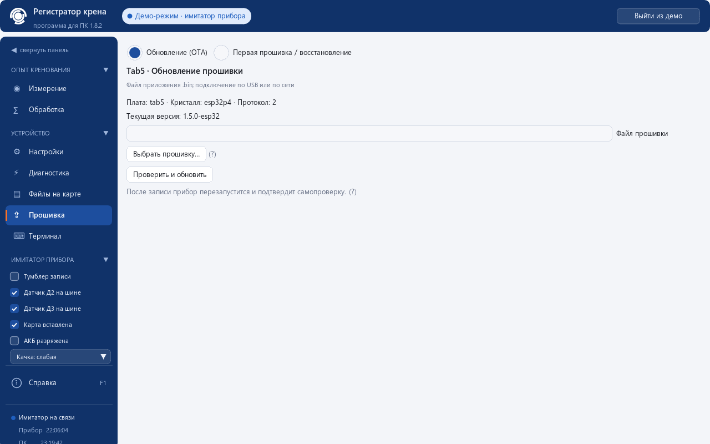
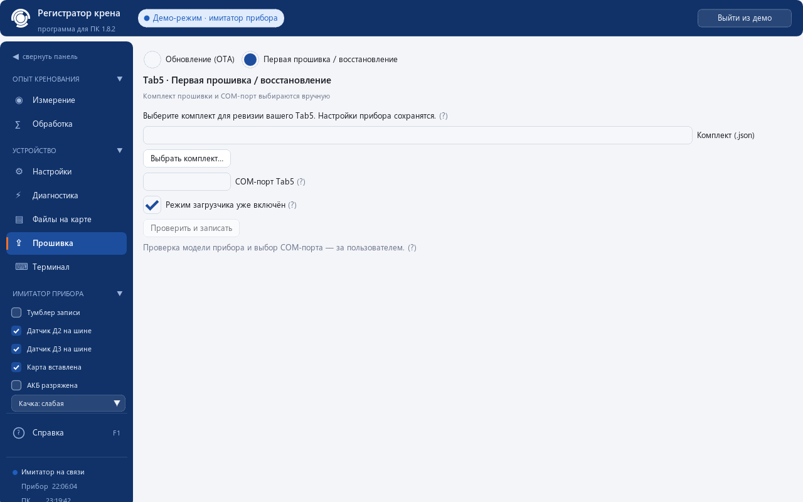

# Tab5 PC fork (tab5-esp32)

Output is `krenomer-esp32.exe`; the PC application version remains 1.8.2. Device
firmware is independently versioned, starting at 1.5.0-esp32.

## Подписи русской программы

Для первой установки: «Прошивка» → Tab5 → «Первая прошивка / восстановление».
Нажмите «Выбрать комплект…», выберите `krenomer-esp32.json` из папки нужной
ревизии, укажите «COM-порт Tab5» и режим входа в загрузчик. Кнопка
«Проверить и записать» открывает итоговое подтверждение. Все четыре файла
комплекта должны лежать рядом с JSON. Для обновления уже работающего прибора
выберите «Обновление (OTA)», файл приложения `.bin`, затем «Проверить и обновить».
Сетевое подключение — пункт «Tab5 по сети (TCP)…» в выборе порта: IP-адрес,
порт 5000 и ключ доступа (пароль AP). Технические причины ошибок доступны
при наведении. Подписи переведены; команды протокола остаются неизменными.

## Connections

The connection dropdown offers authenticated TCP. Enter a numeric IPv4 address,
port (default 5000), and the unique device token displayed on Tab5 (AP password).
Winsock sockets are nonblocking, including connect and partial send/receive.
Authentication completes before the normal `ver` handshake; the transport hides
the token from the terminal and does not save it. No endpoint discovery is used.

USB runtime uses the same protocol through the P4 native USB Serial/JTAG CDC
port (Espressif VID 303a). Choose its COM port explicitly. Automatic serial
selection remains limited to the original STM32 0483:5740; unrelated ESP boards
are never automatically opened. Wrong version/board/protocol cannot enable OTA.
Measurement has Tab5 `rec on` / `rec off` controls. Missing battery is supported
as external power. Files/downloads preserve F/G/D/E/base64/CRC32 framing.

Native USB runtime and ROM recovery need no Python or esptool runtime, but
both require a working USB Serial/JTAG **COM driver**. Espressif documents manual
driver installation for Windows 7/8; see the [official driver guide](https://docs.espressif.com/projects/esp-iot-solution/en/latest/usb/usb_overview/usb_serial_jtag.html).
The serial interface uses usbser / USB Serial (CDC); JTAG is a separate interface.
No drivers were downloaded or installed for this work. Actual Windows 7 with
this driver and a physical Tab5 remains untested.

## Firmware modes

Select **Tab5 ESP32 OTA / Factory ROM** on the firmware page, including when no
runtime firmware is connected. These modes are separate from STM32 DFU.

OTA selects only an IDF application .bin. The checker verifies P4 chip id 18,
`krenomer-esp32` app descriptor, `-esp32` version suffix, segment bounds/checksum,
and the appended SHA256. Factory/full-flash, C6 and corrupt images are rejected.
Signed-image trailers are deliberately unsupported in this fork. Recording blocks
upload. Same-version reinstall is allowed for recovery; the firmware also enforces
its version policy. The exact byte count and full-image SHA256 go to the device.

Authoritative protocol2 grammar (see also ../tab5/PROTOCOL.md):

```
auth TOKEN                          -> OK
ota info                            -> JSON, OK
ota begin tab5 esp32p4 2 VERSION SIZE SHA256 -> OK ota offset=0
ota chunk OFFSET HEX                -> OK ota offset=NEXT
ota end                             -> OK ota committed scheduled reboot
ota abort                           -> OK ota aborted
ota status                          -> OK ota offset=N active=0|1
```

Info must identify board=tab5, chip=esp32p4, proto=2 and report version, max_size,
recording and boot_confirmed. Chunk payload is at most 256 bytes. One lost chunk
acknowledgement retries the identical last chunk once. Disconnect aborts the
session; a new attempt starts at zero. Completion requires a NEW connection with
the expected version and `boot_confirmed:true`. Pending trial and rollback never
count as success; boot verification has a 120s timeout.

Factory/ROM takes the explicit package JSON `factory_parts` manifest and an
explicit COM number. The user must identify and explicitly choose the physical
Tab5. ROM identifies P4 chip, silicon revision and security state; it cannot prove
the board is Tab5 because there is no Tab5 board-ID fuse. The vetted manifest
identifies the intended layout. OTA separately checks firmware-reported exact
board/chip/protocol. It prevalidates all files before opening the port. Required
parts are bootloader@0x2000, partition table@0x8000, application@0x20000 and
8192 FF bytes of initialized OTA metadata@0xf000. NVS is preserved. Resetting OTA
metadata after application verification selects ota_0 even when recovery began
with stale ota_1 selection. Native Windows overlapped serial at115200 8N1 and
SLIP ROM commands need no Python/esptool installation. Manual BOOT mode is the
default; automatic native USB DTR/RTS is explicit. Cancel/failure does not request
application launch. Recovery retries the complete vetted plan. ROM checks both
image revision ranges before erase. The normal SDK profile targets silicon
revision100..199; the separate `tab5/build-rev3` SDK profile targets300..399.
Use a package built for the actual silicon; image headers are never patched.
Revisions301/302 use the official flash-power sequence, including the ECO7
already-powered branch, without eFuse writes. See [ROM_POWER_SEQUENCE.md](ROM_POWER_SEQUENCE.md).

## Build and verification

Portable entrypoint: `build-tab5.cmd x64` or `build-tab5.cmd x86`. It discovers
Visual Studio, configures a new local architecture-specific directory, builds,
checks Win7 imports and runs all eight test suites. To reuse an existing static
vcpkg installation without modifying it, pass its installation root as argument2:
`build-tab5.cmd x64 PATH_TO_EXISTING_VCPKG_INSTALLED`. No machine-specific paths
are embedded in the public script. Set VCPKG_ROOT if needed.

Use the existing build-win7.cmd / build-win7-x86.cmd with MSVC v143 and the static
vcpkg triplet; outputs now carry the esp32 suffix. Existing vcpkg installations
can be reused with VCPKG_MANIFEST_MODE=OFF and VCPKG_INSTALLED_DIR pointing at the
installation, configuring a NEW build directory inside this pc subtree. Do not
copy/retarget another worktree's CMake cache. Enable KRENOMER_BUILD_TESTS=ON.

`ctest --test-dir BUILD --output-on-failure` runs protocol, link, firmware,
processing, ESP OTA, native ROM, factory-loader and software-rendered UI tests.
No GUI window, OpenGL context or COM port is opened by these tests; the TCP test
binds loopback only. `esp32_test --image PATH` additionally checks the actual IDF
application. `recovery_test --manifest PATH` checks an actual factory package
without opening a transport. Native ROM can also replay a real package through
the mock engine: `esprom_test --package PACKAGE_FOLDER DEVICE_REVISION`. It reads
the four original artifact files, checks both image revision ranges, and asserts
either a full four-part verified write or a safe zero-write rejection. No image
header is modified by the test.

## Validation boundary

Virtual peers and loopback tests exercise PC state machines and failure handling;
they do not prove physical flash, DTR/RTS reset, drivers, radio behavior, or real
power-cut survival. Windows 7 imports are checked during linking; booting these
executables on an actual Windows 7 computer remains a separate hardware check.
Local commits record this work; no push or release is performed.

`tests/run-service-integration.cmd` (optional development test, GCC on PATH)
builds a bridge to the actual production C firmware service parser with only
flash/media boundaries replaced, then runs the PC client against it. Build PC
x64 tests first. GCC/Python are not runtime dependencies of the shipped exe.

Primary format references: [ESP image header](https://github.com/espressif/esp-idf/blob/v5.5.2/components/bootloader_support/include/esp_app_format.h),
[app descriptor](https://github.com/espressif/esp-idf/blob/v5.5.2/components/esp_app_format/include/esp_app_desc.h),
[native USB reset behavior](https://github.com/espressif/esptool/blob/v5.1.0/esptool/reset.py).

## Offscreen UI examples

Virtual Tab5, software-rendered without opening a window or a device:




