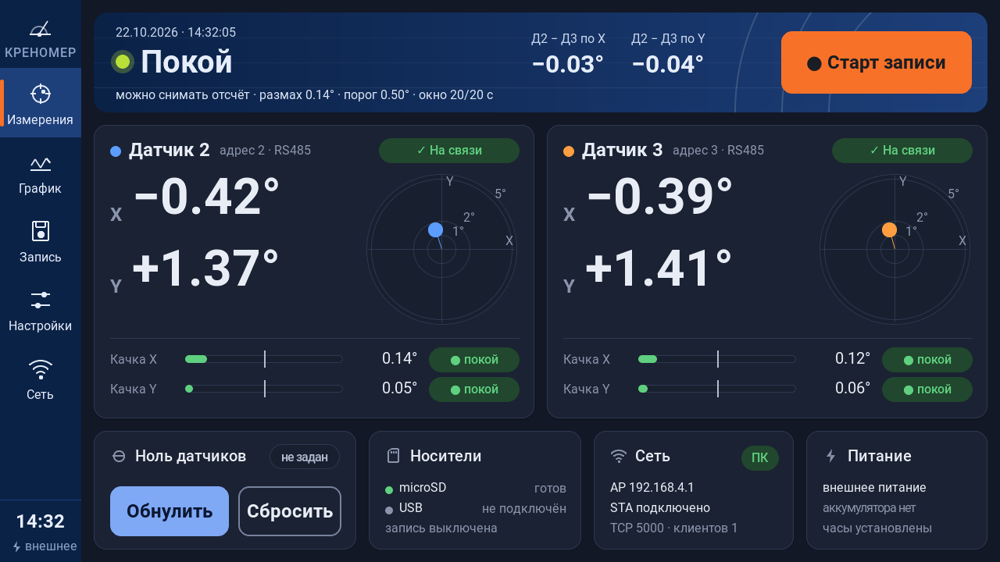
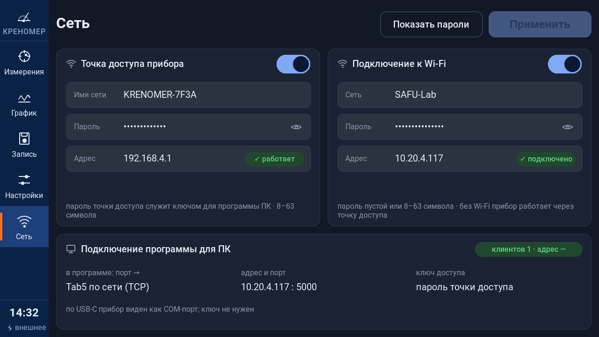

# Регистратор крена: локальный порт M5Stack Tab5

Текущая версия firmware — **1.6.1-esp32** (22.10.2026): новый dashboard в палитре
программы ПК и проверенная цепочка выбора трёх экранов. [Обновление и проверки](UPDATE_1.6.1_2026-10-22.md),
[профили экранов](PANELS.md), [проверки BSP](PANEL_TESTS.md), [дизайн и клики](UI_REDESIGN.md).

Отдельная ветка `tab5-esp32` от `9226894` (ПК 1.8.2). STM32 в
`BWM427_Inclinometer` сохранён без изменений. Это тестовый порт, не прошивка,
подтверждённая испытанием на устройстве. Физические COM/USB в разработке не
открывались; испытаний hardware-in-loop пока нет.

## Платформа

ESP-IDF **5.5.2**, `espressif/m5stack_tab5` **1.3.2**, LVGL **9.3.0**.
Разрешённые версии компонентов фиксируются в `dependencies.lock`.
P4 исполняет приложение; Wi-Fi работает через ESP-Hosted и C6 по SDIO.
Обновление P4 не перепрошивает C6. Версию установленного ESP-Hosted на C6
необходимо проверить при первом аппаратном запуске.

RS485: TX20, RX21, DIR34, 115200 8N1, датчики 2 и 3, пауза не меньше 15 мс,
таймаут ответа 30 мс. Преобразование `(register − 10000)/100`, медиана-3,
EMA и расчёт качки переносятся из STM32. Запись получает только свежие
успешные ответы, без подмены пропущенных отсчётов последним значением.

Экран 1280×720, сенсорное управление, Roboto 16/20/24/32/40/64 px (Regular/Medium/Bold),
знаки DejaVu; лицензии в `assets/fonts/` и `../pc/assets/fonts/`.
Пять страниц предоставленного дизайна: измерения, график, запись, настройки,
сеть. Эталонные материалы находятся в `design/`, настоящие LVGL-снимки — в
`docs/img/`; примеры данных из макета не подставляются вместо состояния прибора.
Штатные ILI9881C/GT911, ST7123 и ST7121 различает BSP при старте.
Сборка по умолчанию рассчитана на **ESP32-P4 rev 1.x (100–199)**; номер ревизии
его экземпляра по видео не установлен. Перед первым физическим flash нужен
`chip_id`, проверка диапазона ревизий образа и доступ к ROM recovery.
Образ для P4 rev 3 нельзя выдавать за совместимый с rev 1 и наоборот.

Аккумулятор необязателен. Tab5 без NP-F работает от внешнего источника;
USB-накопитель увеличивает требования к питанию. Достаточность адаптера и
поведение при его отключении подтверждаются только на железе. Для Tab5
нельзя применять батарейную кривую 3S и порог 10 В из STM32.

## Сборка без подключения устройства

Официальный IDF устанавливается в `../.tools/esp-idf`, инструменты — в
`../.tools/idf-tools`. Эти каталоги игнорируются Git. Для повторения:

```text
git clone --depth 1 --branch v5.5.2 --recursive --shallow-submodules https://github.com/espressif/esp-idf.git ../.tools/esp-idf
set IDF_TOOLS_PATH=<absolute fork path>/.tools/idf-tools
python ../.tools/esp-idf/tools/idf_tools.py install --targets esp32p4
python ../.tools/esp-idf/tools/idf_tools.py install-python-env
build.cmd
build.cmd rev3
```

`build.cmd` только собирает, не перечисляет порты и не пишет в плату.
`build/krenomer-esp32.bin` — приложение для OTA, **не полный flash image**.
`build/package` содержит приложение, отдельные factory-части, JSON с адресами
и SHA256SUMS. Имя приложения заканчивается `esp32`. Полный flash и OTA
нельзя смешивать. `build.cmd rev3` собирает отдельный настоящий образ IDF
для rev 3.x (300–399) в `build-rev3/package`; заголовки не исправляются вручную.
В программе ПК есть отдельная страница Tab5: OTA и первоначальная установка
четырёх частей через собственный ROM-протокол, без Python во время работы.
Пользователь явно выбирает COM и комплект. Проверяются чип и ревизия до записи,
каждая часть проверяется MD5, otadata пишется последней; NVS сохраняется.
ROM-движок проверяет реальные диапазоны обоих образов. Для 301/302 реализована
официальная последовательность питания flash, включая отдельный путь ECO7
с уже включённым питанием ROM, без записи eFuse. См. [алгоритм](../pc/ROM_POWER_SEQUENCE.md).
OTA использует диапазон самого образа. См. [интеграцию ПК](../pc/TAB5.md).
Физический flash в этой работе не запускался. Не применять `--force` для обхода
несовпадения чипа/ревизии. В Windows 7 может потребоваться драйвер USB Serial/JTAG.

## Проверки

`tests/run-host.cmd` — переносимое ядро и упаковка образа. Дополнительные
виртуальные проверки сервисов и ПК описаны в `TEST_REPORT.md`.
Успешный host-тест не подтверждает работу физического USB,
питания, панели, носителя, датчика или ROM-загрузчика.

Текущий план: [STATUS.md](STATUS.md). Общий протокол: [PROTOCOL.md](PROTOCOL.md).

## Виртуальный экран

Снимки настоящего LVGL, программная отрисовка без окна и устройства:





## Первичные источники

- [M5Stack Tab5: аппаратная документация и история экранов](https://docs.m5stack.com/en/core/Tab5).
- [Официальный BSP Tab5](https://github.com/espressif/esp-bsp/tree/master/bsp/m5stack_tab5).
- [USB Host Espressif](https://docs.espressif.com/projects/esp-usb/en/latest/esp32p4/usb_host.html).
- [OTA и откат ESP-IDF](https://docs.espressif.com/projects/esp-idf/en/v5.5.2/esp32p4/api-reference/system/ota.html).
- [M5Unified RTC RX8130](https://github.com/m5stack/M5Unified/blob/master/src/utility/rtc/RX8130_Class.inl)
  и [INA226](https://github.com/m5stack/M5Unified/blob/master/src/utility/power/INA226_Class.inl)
  используются как справка по регистрам, без включения Arduino runtime.
