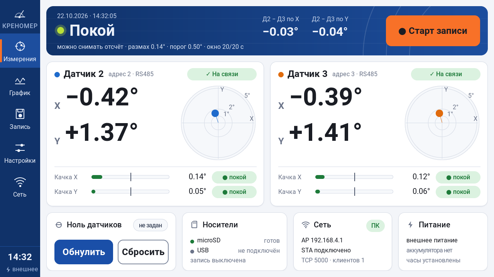
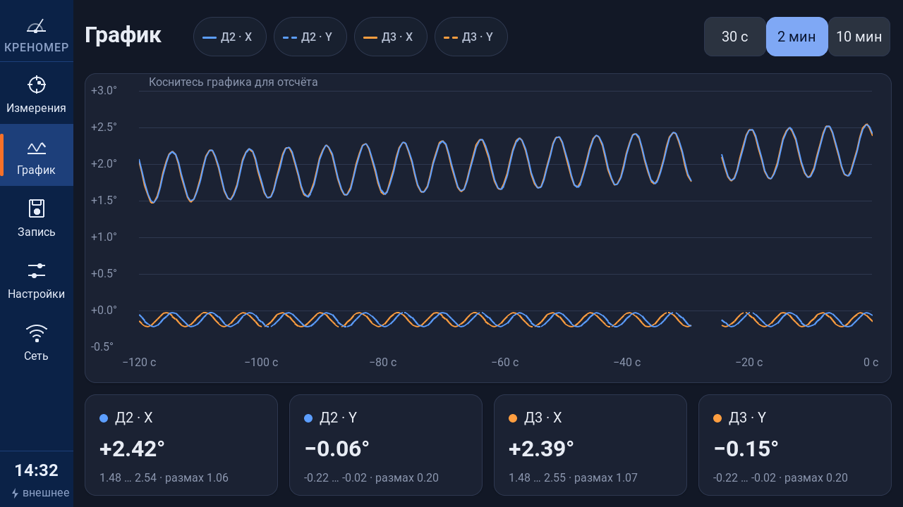

# Tab5 1.6.0-esp32: обновление 22.10.2026

Исторический срез1.6.0; актуальная проверка Roboto/1.6.1 — [новый отчёт](UPDATE_1.6.1_2026-10-22.md).

Готовый локальный результат от `d49218b`. Перенесён предоставленный дизайн,
обе прошивки заново собраны ESP-IDF 5.5.2 после завершения UI. Публикации,
обращений к физическим COM/USB и аппаратного flash не было.

## Интерфейс

Исходный [SPEC](design/SPEC.md), [HTML](design/mockup.html) и [эталоны](design/png/)
отделены от [настоящих LVGL-снимков](docs/img/). Первый отвергнутый dashboard
не включён в итоговые снимки. Сетка 1280×720: rail104, баннер, две карточки
датчиков, круговые уровни, полосы качки с рисками порога и четыре нижние карточки.
Пять страниц: измерения, график, запись, настройки, сеть; обе темы.

Offscreen-рендер использует настоящий LVGL9.3, display flush и pointer indev.
Итог: **76 кадров/сценариев, 30 callback, 0 ошибок геометрии**.
Независимый pixel checker: 10/10 страниц/тем, рамки карточек в пределах ±4px
от SPEC и правильная палитра rail/background. Проверены реальные клики,
stepper/удержание, числовая и RU/EN-клавиатуры, отказ недопустимых чисел/дат,
подтверждение нуля, dirty-navigation, backend feedback и ожидание подтверждения.
Ответы settings/network/time имеют отдельные serial/kind/success: отказ backend
или NVS снимает ожидание, показывает ошибку и оставляет возможность повторить.
Крупные углы ±89.99° не обрезаются. Шрифты16/20/24/28/40/64 проверены по cmap.

График хранит только новые timestamped измерения: 30с при10Гц, 2/10мин при2Гц.
Задержанные отсчёты попадают в свой временной bucket; повторные/устаревшие не
заменяют свежие, пропуски остаются разрывами. Pure graph:14 групп,44661 проверка.
Кривая на снимке — явно синтетическая host fixture, не измерения устройства.

Main передаёт реальные имя/длительность текущей записи, число TCP-клиентов,
дату/время и состояния носителей. Неизвестные объём, история файлов, адрес
TCP-клиента показаны как неизвестные. Нет выдуманного остатка места или таблицы.
Установка времени валидируется по календарю2000–2099 и вызывает существующий
RTC backend; отсутствие RTC не выдаётся за аппаратное сохранение.

## Экран и тач

BSP1.3.2 сам выбирает ST7121/ST7123/ILI9881C+GT911. Tracked wrappers наблюдают
реальные конструкторы, reset/init/on/touch; нет новых проб, сбросов или подбора
драйвера наугад. `managed_components` не изменён.

Найдены две ошибки длины в таблице ST7123: A3=40 при39 параметрах и E8=15 при14.
Официальный M5GFX считает40/15 вместе с кодом команды. Адаптер проверяет точный
payload и меняет только две длины в копии метаданных; байты и timing сохранены.
Host исполняет настоящий init-loop всех трёх драйверов:252 записи, bounded TX,
две исходные OOB воспроизводятся, исправленные трассы проходят;6 мутаций
отвергаются. Ошибки reset/init/on/touch блокируют подтверждение успешного старта.
Подробности: [PANELS](PANELS.md), [PANEL_TESTS](PANEL_TESTS.md).

## Готовые образы

| Silicon P4 | Каталог относительно tab5/ | Размер приложения, байт | SHA-256 приложения |
|---|---|---:|---|
| 100–199 | `build/package` | 1,423,808 | `67356117c804279dd4be42020f9641b8f072b8de8f5ac38e61ce8d012c07fbcf` |
| 300–399 | `build-rev3/package` | 1,425,216 | `d021e376794550d884a4131fe378611e0800f2a03bfd1fa125d811ee20ffc0e9` |

В каждом package: приложение, bootloader0x2000, partition table0x8000,
otadata0xf000, приложение0x20000, JSON и SHA256SUMS. NVS не входит в запись.
Это две настоящие отдельные IDF-сборки; диапазоны заголовков не исправлялись.
Каждый образ содержит все три поддерживаемых профиля экрана.

## Проверки итоговых артефактов

- PC x64 и x86: по8/8 ctest; production EXE прежние, PC1.8.2.
- 28 запусков на двух архитектурах и двух package: полная OTA1.5→1.6 с передачей
  всех байтов настоящего образа, сверкой версии после reboot/boot confirmation;
  несовместимый silicon отсекается до OTA begin; recovery manifest и ROM
  rev100/300/301/302, а также302 XPD_ON. Это mock устройств, не hardware.
- Production C service parser вместе с C++ PC OTA:77/77.
- Сервисы записи/OTA:234846 проверок; shared startup:86; календарь:20;
  measurement host PASS, package unit4/4, graph14/44661.
- Не изменены STM32, PC production sources, tab5_measure, tab5_services,
  tab5_board. Дополнительно13 функций main с wire/CSV/маршрутизацией байт-в-байт
  совпадают с d49218b. Main дополнен только UI state/time action/panel boot gate.

## Что остаётся проверить на устройстве

Реальный экземпляр Tab5 не опрашивался. Не подтверждены DSI/тач, конкретная
ревизия P4, питание, версия C6, параллельная работа microSD/USB-A/USB-C,
длительная запись, power-cut и rollback. Батарея необязательна. Локальные
регрессии и рендер не заменяют эти испытания. Windows7 здесь не загружалась;
совместимость EXE ограничена проверками импортов и сборкой.
