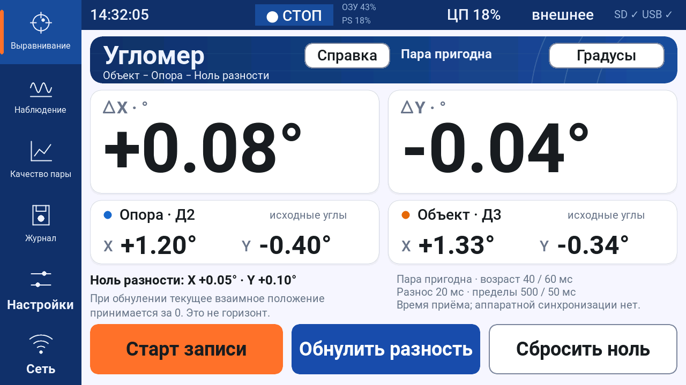
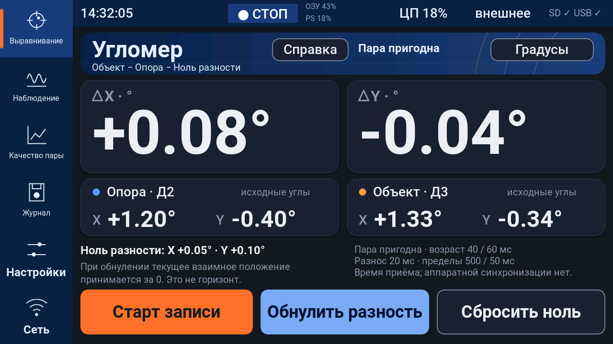

# Tab5 1.8.7 — галерея интерфейса

Все PNG — 1280×720, штатный native RGB565 рендерер настоящего Tab5 UI. Входы только синтетические хост-фикстуры. Эти изображения не являются аппаратными измерениями или проверкой собранной прошивки.

CPU, память, носители, часы, сеть и углы заданы демонстрационным состоянием. SSID демонстрационные, IP из 192.0.2.0/24, ключи скрывает обычный UI. Номер прошивки в настройках задан фикстурой.

## Инвентаризация

Креномер: Углы, Качка, График, Запись, Настройки, Сеть. Угломер: Выравнивание, Наблюдение, Качество пары, Журнал, Настройки, Сеть. Каждая страница показана в светлой и тёмной темах.

Настройки и сеть прокручиваются: дополнительные PNG показывают их разделы, а не новые вкладки. Основные страницы (`main`), справка (`help`), диалоги (`dialog`) и граничные проверки (`validation`) разделены. Имена файлов, роли, темы, происхождение и SHA-256 перечислены в `manifest.json`.

## Основные изображения для слайдов

| Режим / страница | Светлая тема | Тёмная тема |
|---|---|---|
| Креномер / Углы | [demo_heel_angles_light.png](main/demo_heel_angles_light.png) | [demo_heel_angles_dark.png](main/demo_heel_angles_dark.png) |
| Креномер / Качка | [demo_heel_rolling_light.png](main/demo_heel_rolling_light.png) | [demo_heel_rolling_dark.png](main/demo_heel_rolling_dark.png) |
| Креномер / График | [demo_heel_chart_light.png](main/demo_heel_chart_light.png) | [demo_heel_chart_dark.png](main/demo_heel_chart_dark.png) |
| Креномер / Запись | [demo_heel_recording_light.png](main/demo_heel_recording_light.png) | [demo_heel_recording_dark.png](main/demo_heel_recording_dark.png) |
| Креномер / Настройки: опрос | [demo_heel_settings_light.png](main/demo_heel_settings_light.png) | [demo_heel_settings_dark.png](main/demo_heel_settings_dark.png) |
| Креномер / Настройки: качка | [demo_heel_settings_rolling_light.png](main/demo_heel_settings_rolling_light.png) | [demo_heel_settings_rolling_dark.png](main/demo_heel_settings_rolling_dark.png) |
| Креномер / Настройки: параметры покоя | [demo_heel_settings_rolling_more_light.png](main/demo_heel_settings_rolling_more_light.png) | [demo_heel_settings_rolling_more_dark.png](main/demo_heel_settings_rolling_more_dark.png) |
| Креномер / Настройки: прибор, тема, часы | [demo_heel_settings_device_light.png](main/demo_heel_settings_device_light.png) | [demo_heel_settings_device_dark.png](main/demo_heel_settings_device_dark.png) |
| Креномер / Настройки: экран, прошивка, выключение, синхронизация | [demo_heel_settings_bottom_light.png](main/demo_heel_settings_bottom_light.png) | [demo_heel_settings_bottom_dark.png](main/demo_heel_settings_bottom_dark.png) |
| Креномер / Сеть: точка доступа | [demo_heel_network_light.png](main/demo_heel_network_light.png) | [demo_heel_network_dark.png](main/demo_heel_network_dark.png) |
| Креномер / Сеть: подключение Wi-Fi | [demo_heel_network_bottom_light.png](main/demo_heel_network_bottom_light.png) | [demo_heel_network_bottom_dark.png](main/demo_heel_network_bottom_dark.png) |
| Угломер / Угломер / выравнивание | [demo_level_alignment_light.png](main/demo_level_alignment_light.png) | [demo_level_alignment_dark.png](main/demo_level_alignment_dark.png) |
| Угломер / Наблюдение | [demo_level_observation_light.png](main/demo_level_observation_light.png) | [demo_level_observation_dark.png](main/demo_level_observation_dark.png) |
| Угломер / Качество пары | [demo_level_quality_light.png](main/demo_level_quality_light.png) | [demo_level_quality_dark.png](main/demo_level_quality_dark.png) |
| Угломер / Журнал | [demo_level_journal_light.png](main/demo_level_journal_light.png) | [demo_level_journal_dark.png](main/demo_level_journal_dark.png) |
| Угломер / Настройки: опрос | [demo_level_settings_light.png](main/demo_level_settings_light.png) | [demo_level_settings_dark.png](main/demo_level_settings_dark.png) |
| Угломер / Настройки: качка | [demo_level_settings_rolling_light.png](main/demo_level_settings_rolling_light.png) | [demo_level_settings_rolling_dark.png](main/demo_level_settings_rolling_dark.png) |
| Угломер / Настройки: параметры покоя | [demo_level_settings_rolling_more_light.png](main/demo_level_settings_rolling_more_light.png) | [demo_level_settings_rolling_more_dark.png](main/demo_level_settings_rolling_more_dark.png) |
| Угломер / Настройки: прибор, тема, часы | [demo_level_settings_device_light.png](main/demo_level_settings_device_light.png) | [demo_level_settings_device_dark.png](main/demo_level_settings_device_dark.png) |
| Угломер / Настройки: экран, прошивка, выключение, синхронизация | [demo_level_settings_bottom_light.png](main/demo_level_settings_bottom_light.png) | [demo_level_settings_bottom_dark.png](main/demo_level_settings_bottom_dark.png) |
| Угломер / Сеть: точка доступа | [demo_level_network_light.png](main/demo_level_network_light.png) | [demo_level_network_dark.png](main/demo_level_network_dark.png) |
| Угломер / Сеть: подключение Wi-Fi | [demo_level_network_bottom_light.png](main/demo_level_network_bottom_light.png) | [demo_level_network_bottom_dark.png](main/demo_level_network_bottom_dark.png) |





## Справка, диалоги и проверки

| Группа / экран | Светлая тема | Тёмная тема |
|---|---|---|
| help / help_01 | [demo_shared_help_01_light.png](help/demo_shared_help_01_light.png) | [demo_shared_help_01_dark.png](help/demo_shared_help_01_dark.png) |
| help / help_02 | [demo_shared_help_02_light.png](help/demo_shared_help_02_light.png) | [demo_shared_help_02_dark.png](help/demo_shared_help_02_dark.png) |
| help / help_03 | [demo_shared_help_03_light.png](help/demo_shared_help_03_light.png) | [demo_shared_help_03_dark.png](help/demo_shared_help_03_dark.png) |
| help / help_04 | [demo_shared_help_04_light.png](help/demo_shared_help_04_light.png) | [demo_shared_help_04_dark.png](help/demo_shared_help_04_dark.png) |
| help / help_05 | [demo_shared_help_05_light.png](help/demo_shared_help_05_light.png) | [demo_shared_help_05_dark.png](help/demo_shared_help_05_dark.png) |
| help / help_06 | [demo_shared_help_06_light.png](help/demo_shared_help_06_light.png) | [demo_shared_help_06_dark.png](help/demo_shared_help_06_dark.png) |
| help / help_07 | [demo_shared_help_07_light.png](help/demo_shared_help_07_light.png) | [demo_shared_help_07_dark.png](help/demo_shared_help_07_dark.png) |
| help / help_08 | [demo_shared_help_08_light.png](help/demo_shared_help_08_light.png) | [demo_shared_help_08_dark.png](help/demo_shared_help_08_dark.png) |
| dialog / instrument_roles | [demo_shared_instrument_roles_light.png](dialog/demo_shared_instrument_roles_light.png) | [demo_shared_instrument_roles_dark.png](dialog/demo_shared_instrument_roles_dark.png) |
| dialog / observation_options | [demo_level_observation_options_light.png](dialog/demo_level_observation_options_light.png) | [demo_level_observation_options_dark.png](dialog/demo_level_observation_options_dark.png) |
| dialog / date_time | [demo_shared_date_time_light.png](dialog/demo_shared_date_time_light.png) | [demo_shared_date_time_dark.png](dialog/demo_shared_date_time_dark.png) |
| dialog / numeric_keyboard | [demo_shared_numeric_keyboard_light.png](dialog/demo_shared_numeric_keyboard_light.png) | [demo_shared_numeric_keyboard_dark.png](dialog/demo_shared_numeric_keyboard_dark.png) |
| dialog / network_keyboard | [demo_shared_network_keyboard_light.png](dialog/demo_shared_network_keyboard_light.png) | [demo_shared_network_keyboard_dark.png](dialog/demo_shared_network_keyboard_dark.png) |
| validation / full_angles | [demo_level_full_angles_light.png](validation/demo_level_full_angles_light.png) | [demo_level_full_angles_dark.png](validation/demo_level_full_angles_dark.png) |
| validation / range_message | [demo_level_range_message_light.png](validation/demo_level_range_message_light.png) | [demo_level_range_message_dark.png](validation/demo_level_range_message_dark.png) |
| validation / slope_limit | [demo_level_slope_limit_light.png](validation/demo_level_slope_limit_light.png) | [demo_level_slope_limit_dark.png](validation/demo_level_slope_limit_dark.png) |
| validation / stale_pair | [demo_level_stale_pair_light.png](validation/demo_level_stale_pair_light.png) | [demo_level_stale_pair_dark.png](validation/demo_level_stale_pair_dark.png) |

## Источники и повторение

Стенд: [test_presentation_ui.c](../../tests/test_presentation_ui.c). Запуск: [render_presentation.py](../../tests/render_presentation.py). Состояние пары и наблюдения получают настоящие tab5_relative / tab5_workspace; обычные страницы не заменяются макетными слоями.

```text
python tab5/tests/render_presentation.py --out .tools/tab5-presentation --publish tab5/docs/ui-1.8.7
```

Нужны GCC и Python с Pillow. Окно, UART/COM и устройство не используются. Рабочая папка `--out` содержит технические результаты; `--publish` содержит только PNG, manifest.json и README.md.

В угломере разности используют настоящий Roboto 128 px с контролируемым переходом к 108 px для длинных чисел; исходные углы — 48 px. Проверены градусы, мм/м, ±180°, трёхзначные углы, знак и градус, диапазон tan около 90°, доступность Справки и переключателя единиц. Протокол и измерительные вычисления не менялись.
